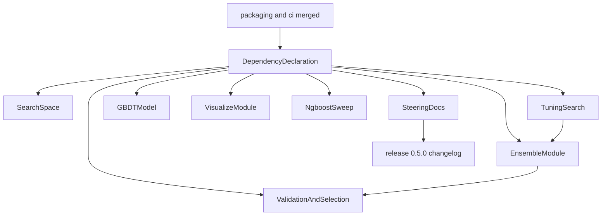
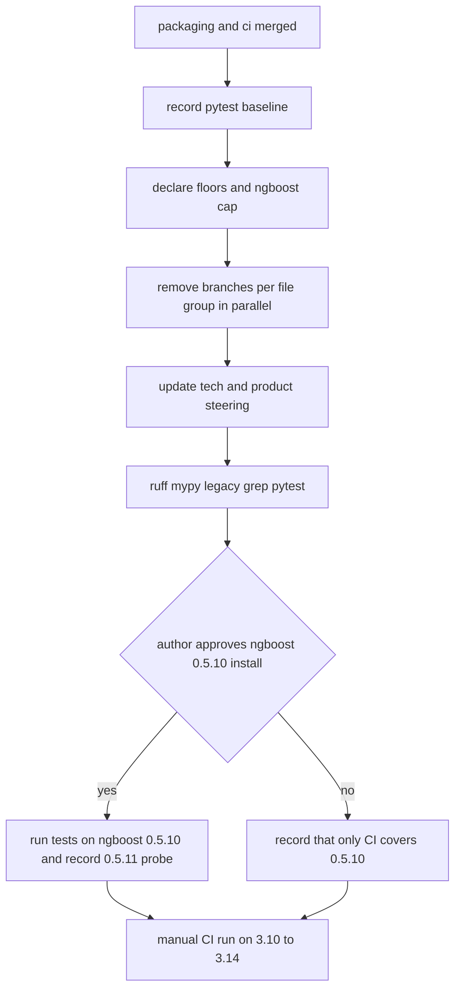

# Design Document: drop-legacy-compat

## Overview
**Purpose**: yikit 0.5.0 から、ライブラリの古い版のための分岐とそのテストをなくし、依存の下限と上限を「残るコードが実際に使う機能のある版」にそろえる。Python 3.14 でも ngboost を入れる。
**Users**: yikit の作者（保守とレビュー）、release-0.5.0（CHANGELOG を書く）、yikit を入れる利用者（licond など）。
**Impact**: 依存の宣言が `scikit-learn>=1.0`、`seaborn>=0.12`、`lightgbm>=4.0`、`ngboost>=0.4,<0.5.11`（Python の版による除外なし）、`optuna>=3.2`、`optuna-integration>=4.1` になる。`src/yikit` から 0.4.x の古い環境のための判定・import の代わりの場所・上書きが消え、テストから古い版を真似るものと skip が消える。宣言した範囲の版では、公開 API と計算の結果を変えない。steering の `tech.md`（互換性・Key Libraries・Framework・Core deps）と `product.md` を 0.5.0 の方針にする。

### Goals
- 下限を書くのは、分岐を消したライブラリだけで、版はそれぞれ使う機能が入った最初の版（根拠はソースか changelog）
- ngboost は Python 3.10〜3.14 のすべてで入り、上限は yikit の振る舞いが変わらないと確かめた版まで
- 「分岐の一覧」の「消す」の行がすべて消え、「残す」の行はそのまま。下限より古い版を書いたコメントを探す `grep` が、観察の記録 1 行だけを出す
- Python 3.10〜3.14 の CI で pytest が通り、手元の ruff・mypy がエラー 0 件

### Non-Goals
- Python の版、ビルド、版番号、workflow、ruff・mypy の対象の版、Python 3.8・3.9 向けの書き分け（packaging-and-ci）
- ngboost 0.5.11 への対応（入れ子の名前を渡す `set_params` に合わせた判定・警告・docstring の変更）
- 下限の版を入れて試す CI の job、CI での ruff・mypy
- 新しい機能、公開 API の変更、下限以上の版の違いのための分岐の整理
- CHANGELOG の本文、tag、リリース（release-0.5.0）

## Boundary Commitments

### This Spec Owns
- `pyproject.toml` の `[project] dependencies` と `[project.optional-dependencies] optional` にあるライブラリの行（下限・上限・環境の条件）。`typing_extensions` の行は除く
- `src/yikit` のうち、ライブラリの古い版のための分岐と、下限より古い版を書いた docstring・コメント（「分岐の一覧」の行）
- `models/_ensemble.py` の特徴量の名前の判定を `helpers/_validation.py` の `feature_names_of` に寄せること
- 上の削除に対応するテストの削除・書き換えと、消した処理が前提にしていたライブラリの振る舞いを確かめるテストの追加
- steering の `tech.md` の「互換性」「Key Libraries」、Core Technologies の Framework と Core deps の行。`product.md` の古い環境についての 2 つの記述
- 0.5.0 の CHANGELOG の材料（tasks.md の Implementation Notes）

### Out of Boundary
- `pyproject.toml` の `[build-system]`、`requires-python`、classifiers、license、版、`typing_extensions` の行、`[tool.*]`（packaging-and-ci）
- Python の版による分岐（`sys.version_info`）と `helpers/_helpers.py`・`visualize/_yyplot.py`・`visualize/_utils.py` の import の書き換え（packaging-and-ci）。`_yyplot.py` でこの spec が触るのは `NDArray` のコメントと `_rmse` の docstring だけ
- `tech.md` の Core Technologies の Language、「型」、「コードの品質」、「テスト」の CI の項目、「Development Environment」、「Release」（packaging-and-ci）。Architecture、sklearn の estimator の決まり、Key Technical Decisions も触らない
- 下限以上の版の違いのための分岐（「分岐の一覧」の「残す」）
- `is_installed()` で optional の依存を見て公開する仕組み
- ngboost 0.5.11 以降に yikit を合わせるコードの変更、dependabot の設定、CI の workflow
- `examples/`、`docs_src/`、`README.md`（版の分岐や記述がないことを確かめた）

### Allowed Dependencies
- packaging-and-ci が main に入っていること（Python>=3.10、CI の 3.10〜3.14、ruff の `py310`・mypy の `3.10`、`typing_extensions` の行の削除、setuptools-scm での版）
- `models` → `helpers`（`yikit.helpers._validation.feature_names_of`）。structure.md の依存の向き（models は基盤だけに依存する）に合う。逆向き（helpers → models）は作らない
- 新しいライブラリは足さない。手元で ngboost 0.5.10（と、調べるためだけの 0.5.11）を入れるのは作者の承認の後
- 確かめに使うのは yikit-dev（Python 3.12）の pytest・ruff・mypy と、GitHub Actions の CI の手動実行

### Revalidation Triggers
- ngboost の上限を変えるとき（0.5.11 への対応）: `ignores_nested_set_params` と `ParamDistributions` の警告、`EnsembleRegressor` の docstring、`find_unspecified_random_states`・`apply_params` のテスト、`log_likelihood` が使う `pred_dist(X)._params`・`manifold`・`total_score` を、新しい版のソースとテストで確かめ直す
- optuna-integration の `OptunaSearchCV` の `predict` や `param_distributions` の扱いが変わったとき: `OptunaSearchRegressor` と `test_search_cv.py` を確かめる
- `requires-python` や CI の行列を変えたとき: 「分岐の一覧」の「残す」の行（scikit-learn 1.6・1.9、LightGBM 4.7、matplotlib<3.10、joblib<1.3）が、まだ範囲の中にあるかを見直す
- 下限をさらに上げるとき: その下限で消せる「残す」の行を探す（例: scikit-learn>=1.6 なら `_estimator_type`）
- release-0.5.0: CHANGELOG の材料（下限・上限・環境の条件と理由）を使う。licond は上げた下限を満たす必要がある

## Architecture

### Existing Architecture Analysis
- 分岐は 3 つの形で入っている: 版の番号の比較（`sklearn.__version__` の正規表現）、引数・属性の有無（`inspect.signature`、`is_argument`、`hasattr`、`set_params` の同一性）、import の代わりの場所（`try/except ImportError`）。どれも 1 つの関数か 1 つの import の中に閉じていて、公開 API の形を変えない
- `helpers/_validation.py` の `feature_names_of` と `models/_ensemble.py` の `_feature_names` は、版の判定を含めて同じ処理を 2 か所に持っている（module-quality と ensemble-on-sklearn が別々に入れた）
- テストは、版を差し替える（`monkeypatch.setattr(sklearn, "__version__", ...)`）、署名を差し替える（`_FIT_PARAMETERS`）、古い親のクラスを真似る（`_PropertyPredictSearchCV`）、入っている版で skip する、の 4 つの形で古い版を扱っている
- packaging-and-ci は同じ `pyproject.toml` と `tech.md` と `visualize/_yyplot.py` を触るが、触る行と節は分かれている（Boundary Commitments）。この spec はその後に実装するので、作業のときの衝突はない

### Architecture Pattern & Boundary Map



**Architecture Integration**:
- Selected pattern: 宣言（DependencyDeclaration）が先に下限を決め、その下限を前提に、ファイルのまとまりごとの掃除（7 つの Sweep）が分岐を消す。下限の理由は宣言と steering の 1 か所に書き、各 Sweep はそれを参照する
- Domain/feature boundaries: 掃除はライブラリごとではなく、モジュールとそのテストの組ごとに切る。同じファイルに複数のライブラリの分岐がある（例: `_search_space.py` に scikit-learn と ngboost）ので、ライブラリで切るとファイルが重なり並行できない（research.md の比較）
- 依存の向き: DependencyDeclaration → 各 Sweep → SteeringDocs。Sweep どうしは互いのファイルを触らない。EnsembleModule は ValidationAndSelection の持つ `feature_names_of` を import するが、そのシグネチャと結果は変わらないので、この点では順番に依らない。ただし EnsembleModule の import を塞ぐテスト（`optuna_integration` だけを塞ぐ）は、TuningSearch が `optuna.integration` への切り替えを消した後でないと通らない（optuna 5 の `optuna.integration` は、塞がれた import を `name` のない `ModuleNotFoundError` にして出し直す）ので、EnsembleModule は TuningSearch の後に行う
- Existing patterns preserved: optional の依存の条件付きの公開、`TYPE_CHECKING` の中の型のための import、新しい版の違いを引数・属性の有無で分ける書き方、英語の docstring とコメント
- Steering compliance: 公開 API と結果を変えない、ruff・mypy は手元、下限は消した分岐が要る分だけ（作者の決定）

### Technology Stack

| Layer | Choice / Version | Role in Feature | Notes |
|-------|------------------|-----------------|-------|
| 必須の依存 | scikit-learn>=1.0、seaborn>=0.12。numpy・pandas・scipy・joblib・matplotlib は下限なし | 下限の宣言 | Python 3.10 では scikit-learn 1.7、3.11 以上では 1.9 が入る |
| optional の依存 | lightgbm>=4.0、ngboost>=0.4,<0.5.11、optuna>=3.2、optuna-integration>=4.1、Boruta>=0.4.3（変えない）、colorlog・tqdm（下限なし） | 下限・上限の宣言 | CI の全版で lightgbm 4.7、ngboost 0.5.10、optuna 5.0、optuna-integration 5.0 が入る |
| 確かめ（手元） | yikit-dev（Python 3.12、scikit-learn 1.9.1、lightgbm 4.7.0、ngboost 0.5.8、optuna 5.0.0、optuna-integration 5.0.0、seaborn 0.13.2）、ruff、mypy、pytest | テストと静的検査 | ngboost 0.5.10 は作者の承認の後に入れる |
| 確かめ（CI） | packaging-and-ci の CI（Python 3.10〜3.14、`pip install ".[test,optional]"`、`pytest -ra`） | 依存の解決とテスト | 3.14 でも ngboost が入り、lifelines を通じて pandas<3.0 になる |

## File Structure Plan

新しいファイルはない。すべて既存のファイルの変更（削除と書き換え）。

### Modified Files
- `pyproject.toml`（DependencyDeclaration） — `dependencies` の `scikit-learn>=0.24.1` を `scikit-learn>=1.0`、`seaborn` を `seaborn>=0.12` に。`optional` の ngboost の行を `ngboost>=0.4,<0.5.11` にして環境の条件を消し、上限の理由の 1 行のコメントを付ける。`lightgbm` を `lightgbm>=4.0`、`optuna>=3.0` を `optuna>=3.2`、`optuna-integration` を `optuna-integration>=4.1` に。他の行と節は変えない
- `src/yikit/helpers/_validation.py`（ValidationAndSelection） — `_sklearn_has_feature_names` と、`feature_names_of` の中の版の判定・docstring の「scikit-learn older than 1.0」「Raises ValueError」・例の「# None with scikit-learn < 1.0」を消す。使われなくなる `re`・`sklearn` の import を消す
- `src/yikit/feature_selection/_filter.py`（ValidationAndSelection） — `SelectorMixin` の import の `# >= 0.23.2`、`feature_names_in_` の説明の「(with scikit-learn 1.0 or later)」、例の「# scikit-learn >= 1.0」を消す
- `src/yikit/feature_selection/_wrapper.py`（ValidationAndSelection） — 「Without return_df, which boruta < 0.4 does not take.」を、版に触れない説明（`return_df` を渡さないと boruta は ndarray を返す）に書き換える
- `tests/test_helpers.py`（ValidationAndSelection） — `feature_names_of` のテストから、scikit-learn の版の差し替え、1.0 より前で None になるテスト、読めない版で ValueError になるテストを消す。使われなくなる `import sklearn` を消す
- `tests/test_filtermethod.py`（ValidationAndSelection） — `requires_feature_names_out` と `SelectorMixin` の import を消し、2 つのテストを常に実行する
- `src/yikit/models/_search_space.py`（SearchSpace） — `_criterion_choices` の 1.0 より前の `"mse"` の道と docstring の記述を消す（1.9 の道と版の読み取りは残す）。`_build_ignores_nested_set_params` の `set_params` の比較と「Older ngboost」の記述を消し、ngboost が入っていれば `(NGBRegressor,)` を返す。`ignores_nested_set_params` の docstring を合わせる。使われなくなる `BaseEstimator` の import を消す
- `tests/test_search_space.py`（SearchSpace） — `_criterion_choices` の表から `0.24.1`・`0.24.2` の行を消す。`test_ngboost_detection_matches_its_set_params` のコメントを、版に触れない説明（入れ子の名前が効く版でも共有の既定の木を変えないために `Base` を渡す）に書き換え、テストは残す
- `src/yikit/models/_search_cv.py`（TuningSearch） — `optuna.integration` への import の代わりと、module docstring の括弧書きを消す。`predict` の上書きと、class docstring の「old versions of optuna define as a property」を消す。`feature_names_in_` の docstring の「scikit-learn >= 1.0」を消す
- `src/yikit/models/_optuna.py`（TuningSearch） — `ParamDistributions` の Examples の import を `from optuna_integration import OptunaSearchCV` の 1 行にする
- `tests/test_search_cv.py`（TuningSearch） — import の代わりを `pytest.importorskip("optuna_integration")` と通常の import にする。`HAS_FEATURE_NAMES` と 2 か所の skip、`_PropertyPredictSearchCV`・`_OldParentSearchRegressor`・`test_predict_works_when_the_parent_defines_it_as_a_property`、`_make_search` の `search_class` を消す。`predict` が `OptunaSearchCV` の普通のメソッドで、`OptunaSearchRegressor` が上書きしていないことを確かめるテストを足す。使われなくなる `import sklearn` を消す
- `tests/test_optuna.py`（TuningSearch） — `OptunaSearchCV` の import の代わりを消す。`_ngboost_set_params_ignores_nested_names` と、それによる分岐（「ngboost before 0.4.0」）と skip を消す。許容値のコメントから「(about 0.15 between 0.24.1 and 1.9.1)」を消す（値 0.2 は変えない）
- `src/yikit/models/_ensemble.py`（EnsembleModule） — `_sklearn_has_feature_names`・`_feature_names` を消し、`fit` は `feature_names_of` を使う。`re`・`sklearn` の import を消し、`from yikit.helpers._validation import feature_names_of` を足す。`feature_names_in_` の docstring の「Defined only with scikit-learn >= 1.0」を消す。Notes の「nor by any scikit-learn with ngboost 0.3.x」を「nor by older scikit-learn with ngboost before 0.5.2」に直す
- `tests/test_ensemble.py`（EnsembleModule） — `HAS_FEATURE_NAMES` と 2 つの skip、`is HAS_FEATURE_NAMES` の比較（常に True にする）、`_tuning_classes` の import の代わりを消す。import を塞ぐテストの塞ぐ名前を `("optuna_integration",)` にする。使われなくなる `import sklearn` を消す
- `src/yikit/models/_gbdt.py`（GBDTModel） — `_validation_fit_params` の `verbose` の判定と docstring の LightGBM 3 の記述を消す（`eval_X` の分岐は残す）。`best_iteration_` を `self.estimator_.best_iteration_` から読み、属性の docstring の LightGBM 3 の説明と class docstring の「LightGBM 3 and 4」を直す
- `tests/test_gbdt.py`（GBDTModel） — `_fit_3_2`・`_fit_3_3` と `passes_verbose` の次元を消し、どの署名でも `verbose` を渡さないことを確かめる。`best_iteration_` が `estimator_.best_iteration_` と booster の値の両方に等しいことを確かめる
- `src/yikit/visualize/_permutation_importance.py`（VisualizeModule） — `barplot` に `errorbar=None` を常に渡し、`ci` の道と、コメントの「(``ci`` before seaborn 0.12)」と、使われなくなる `is_argument` の import を消す
- `src/yikit/visualize/_yyplot.py`（VisualizeModule） — `NDArray` のコメントを、版に触れない説明（型のためだけの import）にする。`_rmse` の docstring の「(works with scikit-learn >= 0.24.1)」を消す（実装と scikit-learn 1.4 の記述は残す）
- `src/yikit/visualize/_gbdt.py`（VisualizeModule） — 「Without evaluation data, LightGBM 4 records {} and LightGBM 3 None.」を「Without evaluation data, LightGBM records {}.」にする（判定のコードは変えない）
- `tests/test_visualize.py`（VisualizeModule） — 冒頭のコメントの「ngboost is not installed on Python 3.14」を消す。LightGBM の 2 つのコメント（「4.6 on Python 3.8」、「None before」）を直す。`_make_study_without_direction` の `directions` の有無の分岐を消して常に渡す（docstring も直す）。Student's t の `hasattr` の skip を消し、正規分布で代わりに試すテストのコメントから「ngboost < 0.4 has no Student's t」を消す
- `src/yikit/metrics/_ngboost.py`（NgboostSweep） — 「present in ngboost 0.3.6 through 0.5.8」を「the same in the source of ngboost 0.4.0 through 0.5.11」にする
- `tests/test_metrics.py`（NgboostSweep） — LogNormal と CRPScore を外す理由を、0.3.6 ではなく「LogNormal と自然勾配の解き方は 0.5.8 まで 0.3.6 と同じで、学習できない版が範囲に残るため」にする（組み合わせは外したまま）
- `tests/test_params.py`（NgboostSweep） — `deep=False` のコメントを、版に触れない説明にする
- `.kiro/steering/tech.md`（SteeringDocs） — 互換性、Key Libraries、Core Technologies の Framework と Core deps の行、`updated_at`
- `.kiro/steering/product.md`（SteeringDocs） — Target Use Cases と Value Proposition の古い環境についての記述、`updated_at`

### Unchanged Files（確かめた）
- `src/yikit/models/_params.py`（scikit-learn 1.2・1.3・1.9 の状態の受け渡しと、ngboost 0.4.0 以降の `Base` の扱いは範囲の中）
- `src/yikit/helpers/_helpers.py`（joblib 1.3 の `return_as`、`return_generator`。joblib に下限を書かない）
- `src/yikit/visualize/_optuna.py`（`LegendLocType` を `TYPE_CHECKING` で import。matplotlib に下限を書かない）
- `tests/test_boruta.py`（scikit-learn 0.24.1 を含む環境ごとの結果の記録。分岐ではない）
- `tests/conftest.py`、`examples/`、`docs_src/`、`README.md`（古い版の分岐や記述がない）

## 分岐の一覧
下限: scikit-learn 1.0、seaborn 0.12、lightgbm 4.0、ngboost 0.4（上限 0.5.11 未満）、optuna 3.2、optuna-integration 4.1。「消す」は下限より古い版でだけ通るもの、「残す」は下限以上の版の違いか、版ではないもの。

| # | 場所 | 中身 | 版 | 扱い | 理由 |
|---|------|------|----|------|------|
| S1 | `helpers/_validation.py` | `_sklearn_has_feature_names` と `feature_names_of` の判定、docstring | scikit-learn<1.0 | 消す | 1.0 から全 estimator が `feature_names_in_` を持つ |
| S2 | `models/_ensemble.py` | `_sklearn_has_feature_names`・`_feature_names`（S1 の複製） | scikit-learn<1.0 | 消して `feature_names_of` を使う | 判定を消すと S1 と同じ処理（Requirement 3.4） |
| S3 | `models/_ensemble.py` | `feature_names_in_` の「Defined only with scikit-learn >= 1.0」 | 記述 | 消す | S1 と同じ |
| S4 | `models/_ensemble.py` | Notes の「with ngboost 0.3.x」 | 記述 | 「ngboost before 0.5.2」に直す | `_estimator_type` は ngboost 0.5.2 から（ソースで確認）。0.4〜0.5.1 も regressor と見なされない |
| S5 | `models/_ensemble.py` | `is_regressor` の `AttributeError`（scikit-learn >= 1.6） | 1.6 | 残す | 範囲の中 |
| S6 | `models/_ensemble.py` | `n_features_in_` の `AttributeError` | 版ではない | 残す | 最初のモデルが記録しないとき |
| S7 | `models/_search_space.py` | `_criterion_choices` の `"mse"` の道 | scikit-learn<1.0 | 消す | `"squared_error"` は 1.0 から |
| S8 | `models/_search_space.py` | `_criterion_choices` の 1.9 の道 | 1.9 | 残す | Python 3.10 には 1.7 が入る |
| S9 | `models/_search_space.py` | `NGBRegressor.set_params is not BaseEstimator.set_params` と「Older ngboost」 | ngboost<0.4 | 消す | 0.4.0〜0.5.10 は `setattr` だけの `set_params` を持つ（0.3.x は持たない） |
| S10 | `models/_search_cv.py` | `optuna.integration` からの import の代わり、module docstring | optuna 3.x | 消す | `OptunaSearchCV` は optuna-integration>=4.1 から import する |
| S11 | `models/_search_cv.py` | `predict` の上書き、class docstring の説明 | optuna-integration≤4.0.0 | 消す | 4.1.0 から普通のメソッドで、上書きと同じ呼び方（`_check_is_fitted` の後に `best_estimator_.predict(X, **kwargs)`） |
| S12 | `models/_search_cv.py` | `_estimator_type` と `__sklearn_tags__` | scikit-learn<1.6 と >=1.6 | 残す | どちらも範囲の中 |
| S13 | `models/_search_cv.py` | `feature_names_in_` の「scikit-learn >= 1.0」 | 記述 | 消す | S1 と同じ |
| S14 | `models/_optuna.py` | Examples の import の代わり | optuna 3.x | 消す | S10 と同じ |
| S15 | `models/_optuna.py`・`_params.py`・`_search_space.py`・`_ensemble.py` | 「ngboost 0.4.0 or later」「since ngboost 0.4.0」 | 下限と同じ版 | 残す | 範囲の中の振る舞いの説明。上限を変えるときに見直す |
| S16 | `models/_gbdt.py` | `verbose` の判定と docstring | lightgbm<4.0 | 消す | 4.0 の `fit` に `verbose` はない |
| S17 | `models/_gbdt.py` | `eval_X`・`eval_y` の分岐 | lightgbm 4.7 | 残す | 4.0〜4.6 が範囲に残る |
| S18 | `models/_gbdt.py` | `best_iteration_` を booster から読む理由、「LightGBM 3 and 4」 | lightgbm 3 | `estimator_.best_iteration_` を読み、記述を直す | 4.0 から `best_iteration_` は booster の値を写したもの |
| S19 | `visualize/_gbdt.py` | 「LightGBM 3 None」のコメント | lightgbm 3 | コメントだけ直す | `not evals_result` は 4 の `{}` に要る |
| S20 | `visualize/_permutation_importance.py` | `errorbar` と `ci` の書き分け | seaborn<0.12 | 消す | `errorbar` は 0.12 から |
| S21 | `visualize/_permutation_importance.py` | seaborn 0.13 の並びのための `order` | 0.13 | 残す | 範囲の中 |
| S22 | `visualize/_yyplot.py` | `NDArray` の「numpy < 1.21」のコメント | 記述 | 書き換える（import は `TYPE_CHECKING` に残す） | 型のためだけの import。numpy に下限を書かない |
| S23 | `visualize/_yyplot.py` | `_rmse` の「works with scikit-learn >= 0.24.1」 | 記述 | 消す（実装は残す） | scikit-learn の RMSE は 1.4 からで、下限より新しい |
| S24 | `visualize/_yyplot.py`・`visualize/_optuna.py` | matplotlib<3.10 の凡例、`LegendLocType` | matplotlib | 残す | matplotlib に下限を書かない |
| S25 | `metrics/_ngboost.py` | 「0.3.6 through 0.5.8」 | 記述 | 「0.4.0 through 0.5.11」にする | ソースで確かめた範囲を残す |
| S26 | `feature_selection/_filter.py` | `# >= 0.23.2`、「1.0 or later」、例の「>= 1.0」 | 記述 | 消す | S1 と同じ |
| S27 | `feature_selection/_wrapper.py` | 「boruta < 0.4 does not take」 | 記述 | 書き換える | Boruta>=0.4.3 はすでに下限 |
| S28 | `helpers/_helpers.py` | joblib 1.3 の `return_as` と `return_generator` | joblib | 残す | joblib に下限を書かない |
| S29 | `models/_params.py` | `clone` が運ぶ状態（1.2・1.3・1.9） | scikit-learn>=1.2 | 残す | 範囲の中 |
| T1 | `tests/test_helpers.py` | 版の差し替え、1.0 より前・読めない版のテスト | scikit-learn<1.0 | 消す | S1 |
| T2 | `tests/test_filtermethod.py` | `requires_feature_names_out` | scikit-learn<1.0 | 消す | 1.0 から `SelectorMixin.get_feature_names_out` がある |
| T3 | `tests/test_search_space.py` | `0.24.x` の行、「old ngboost (< 0.4.0)」 | scikit-learn<1.0、ngboost<0.4 | 行を消し、コメントを直す（判定のテストは残す） | S7、S9。判定のテストは上限を変えたときに 0.5.11 の違いを捕まえる |
| T4 | `tests/test_search_space.py` | 「Old scikit-learn validates the steps in `__init__`」 | scikit-learn 1.0 | 残す | 1.0 の `Pipeline.__init__` も検証する |
| T5 | `tests/test_search_cv.py` | import の代わり、`HAS_FEATURE_NAMES`、古い親を真似るクラスとテスト | optuna 3.x、optuna-integration≤4.0、scikit-learn<1.0 | 消し、`predict` が普通のメソッドであるテストを足す | S10、S11、S1 |
| T6 | `tests/test_search_cv.py` | `__sklearn_tags__` の skip | 1.6 | 残す | 範囲の中 |
| T7 | `tests/test_optuna.py` | import の代わり、ngboost の `set_params` の判定と分岐・skip、許容値のコメント | optuna 3.x、ngboost<0.4、scikit-learn 0.24 | 消す・直す | S10、S9 |
| T8 | `tests/test_optuna.py` | PLSRegression<1.3 の形 | 1.3 | 残す | 範囲の中 |
| T9 | `tests/test_ensemble.py` | `HAS_FEATURE_NAMES`、import の代わり、塞ぐ名前の `"optuna.integration"` | scikit-learn<1.0、optuna 3.x | 消す | S1、S10 |
| T10 | `tests/test_gbdt.py` | `_fit_3_2`・`_fit_3_3`・`passes_verbose` | lightgbm<4.0 | 消す | S16 |
| T11 | `tests/test_visualize.py` | 3.14 の注記、LightGBM の 2 つのコメント、`create_new_study` の分岐、Student's t の skip とコメント | ngboost<0.4、lightgbm 3、optuna<3.1 | 消す・直す | 下限（`directions` は optuna 3.1 から、`T` は ngboost 0.4.0 にある） |
| T12 | `tests/test_visualize.py` | seaborn 0.13 の並び、matplotlib<3.5 の凡例の順 | seaborn 0.13、matplotlib | 残す | 範囲の中、または下限なし |
| T13 | `tests/test_metrics.py` | LogNormal と CRPScore を外す理由（0.3.6） | 記述 | 理由を直す（外したまま） | `lognormal.py` と自然勾配は 0.5.8 まで 0.3.6 と同じ |
| T14 | `tests/test_params.py` | `deep=False` の「ngboost < 0.4」 | 記述 | 直す | 0.4 以降の `get_params` は `deep` を無視する |
| T15 | `tests/test_params.py`・`test_helpers.py` | scikit-learn 1.2・1.3・1.9、joblib<1.3 の skip | 範囲の中・下限なし | 残す | — |
| T16 | `tests/test_boruta.py` | 環境ごとの結果の記録（0.24.1 を含む） | 記述 | 残す | 分岐ではなく、なぜ順位だけを見るかの根拠 |

## System Flows



- 基準（変更の前の pytest の数）を最初に取る。yikit-dev は editable で作業ツリーを読むので、後からは取り直せない
- 0.5.11 は調べるだけで、上限の外のまま。結果は対応の作業の材料として残す

## Requirements Traceability

| Requirement | Summary | Components | Interfaces | Flows |
|-------------|---------|------------|------------|-------|
| 1.1 | 分岐を消したライブラリに下限 | DependencyDeclaration | 依存の行 | Declare |
| 1.2 | 他のライブラリに新しい下限なし | DependencyDeclaration | 依存の行 | Declare |
| 1.3 | 下限の根拠を一次資料で確かめる | DependencyDeclaration、SteeringDocs | 下限の表、research.md | — |
| 1.4 | 3.10〜3.14 で依存が解決する | DependencyDeclaration | CI の `pip install ".[test,optional]"` | CI |
| 2.1 | Python の版で ngboost を除外しない | DependencyDeclaration | ngboost の行 | Declare |
| 2.2 | 上限は確かめた版まで | DependencyDeclaration、NgboostSweep | `<0.5.11`、ソースの比較 | Approval |
| 2.3 | 3.14 で ngboost のテストが走って通る | VisualizeModule、NgboostSweep、SearchSpace、TuningSearch、EnsembleModule | CI の 3.14 の job | CI |
| 2.4 | 上限の外の版の違いと作業を記録 | DependencyDeclaration、SteeringDocs | Key Libraries、Implementation Notes | NewNgb |
| 3.1 | 下限より古い版の処理を持たない | 7 つの Sweep | 分岐の一覧の「消す」 | Sweeps |
| 3.2 | 範囲の中の分岐を残す | 7 つの Sweep | 分岐の一覧の「残す」 | Sweeps |
| 3.3 | 古い版の記述を持たない | 7 つの Sweep | 分岐の一覧の記述の行、legacy grep | Local |
| 3.4 | 同じ判定を 1 か所に | EnsembleModule、ValidationAndSelection | `feature_names_of` | Sweeps |
| 3.5 | optional の依存がなくても import できる | EnsembleModule、TuningSearch、VisualizeModule | `is_installed()`、関数の中の import | Local |
| 4.1 | 古い版を真似るテストと skip がない | 7 つの Sweep | 分岐の一覧の T 行 | Sweeps |
| 4.2 | 範囲の中の違いのテストを残す | 7 つの Sweep | T4、T6、T8、T12、T15 | Sweeps |
| 4.3 | 消した処理の前提を確かめる | TuningSearch、SearchSpace、GBDTModel | `predict` のテスト、`set_params` の判定のテスト、`best_iteration_` のテスト | Sweeps |
| 4.4 | CI の 3.10〜3.14 で通る | 全体 | CI の手動実行 | CI |
| 4.5 | ruff・mypy が 0 件 | 全体 | 手元の検査 | Local |
| 5.1 | 公開 API を変えない | 7 つの Sweep | 公開の名前と引数 | Local |
| 5.2 | 範囲の中で同じ結果 | 7 つの Sweep | 既存のテストの数の比較 | Local |
| 5.3 | 結果が変わる分岐は残す | 7 つの Sweep | 分岐の一覧の判断 | Sweeps |
| 5.4 | optuna-integration なしで ImportError | EnsembleModule、TuningSearch | `_import_search_regressor`、import を塞ぐテスト | Sweeps |
| 6.1 | tech.md を 0.5.0 に | SteeringDocs | 互換性・Key Libraries・Framework・Core deps | Steering |
| 6.2 | product.md を 0.5.0 に | SteeringDocs | 2 つの記述 | Steering |
| 6.3 | packaging-and-ci の節を変えない | SteeringDocs | 書き換えの範囲 | Steering |
| 7.1 | CHANGELOG の材料 | SteeringDocs（tasks.md の Implementation Notes） | 材料の一覧 | — |
| 7.2 | 入れるときは承認 | — | 承認の手順 | Approval |
| 7.3 | 下限の CI の job・tag・リリースをしない | — | 作業の範囲 | — |
| 7.4 | 古い環境に入れない | — | 作業の範囲 | — |

## Components and Interfaces

| Component | Domain/Layer | Intent | Req Coverage | Key Dependencies (P0/P1) | Contracts |
|-----------|--------------|--------|--------------|--------------------------|-----------|
| DependencyDeclaration | パッケージの宣言 | ライブラリの下限・上限・環境の条件を宣言する | 1.1–1.4, 2.1, 2.2, 2.4 | packaging-and-ci の `pyproject.toml`（P0） | State |
| ValidationAndSelection | helpers・feature_selection | `feature_names_of` から版の判定を消し、feature_selection の記述を直す | 3.1–3.5, 4.1, 4.2, 5.1–5.3 | scikit-learn>=1.0（P0） | Service |
| SearchSpace | models | `criterion` の候補と、入れ子の名前を無視するモデルの判定から古い版の道を消す | 2.3, 3.1–3.3, 4.1–4.3, 5.1–5.3 | scikit-learn>=1.0、ngboost>=0.4（P0） | Service |
| TuningSearch | models | `OptunaSearchCV` の import と `predict` を optuna-integration>=4.1 に任せる | 2.3, 3.1–3.3, 3.5, 4.1–4.3, 5.1–5.4 | optuna-integration>=4.1、optuna>=3.2（P0） | Service |
| EnsembleModule | models | 特徴量の名前の判定を `feature_names_of` に寄せ、記述とテストを直す | 2.3, 3.1–3.5, 4.1, 4.2, 5.1–5.4 | ValidationAndSelection の `feature_names_of`（P1） | Service |
| GBDTModel | models | LightGBM 3 のための判定と記述を消す | 3.1–3.3, 4.1–4.3, 5.1–5.3 | lightgbm>=4.0（P0） | Service |
| VisualizeModule | visualize | seaborn<0.12 の書き分けと、古い版の記述・テストの分岐を消す | 2.3, 3.1–3.3, 3.5, 4.1, 4.2, 5.1–5.3 | seaborn>=0.12、lightgbm>=4.0、ngboost>=0.4、optuna>=3.2（P0） | — |
| NgboostSweep | metrics・テスト | `log_likelihood` の非公開の属性の確認範囲と、ngboost のテストの記述を直す | 2.2, 2.3, 3.3, 4.1 | ngboost>=0.4,<0.5.11（P0） | — |
| SteeringDocs | steering | tech.md と product.md を 0.5.0 の方針にし、CHANGELOG の材料を残す | 1.3, 2.4, 6.1–6.3, 7.1 | 他のすべて（P1） | — |

### パッケージの宣言

#### DependencyDeclaration

| Field | Detail |
|-------|--------|
| Intent | `pyproject.toml` のライブラリの依存の行を、消した分岐の要る版にそろえる |
| Requirements | 1.1, 1.2, 1.3, 1.4, 2.1, 2.2, 2.4 |

**Responsibilities & Constraints**
- packaging-and-ci の後の `dependencies` と `optional` のライブラリの行だけを変える。行の順番、他の extra（`test`・`dev`・`docs`）、他の節は変えない
- ngboost の行の上に、上限の理由の 1 行のコメントを置く（例: `# <0.5.11: 0.5.11 changes set_params/get_params of nested names; see tech.md.`）

**Contracts**: State [x]

| 行 | 今（packaging-and-ci の後） | 0.5.0 | 根拠（使う機能と、それが入った版） |
|----|------|------|------|
| scikit-learn | `>=0.24.1` | `>=1.0` | `feature_names_in_`、`SelectorMixin.get_feature_names_out`、木の `"squared_error"`（1.0.0 の changelog、1.0.X のソース） |
| seaborn | 下限なし | `>=0.12` | `barplot(errorbar=...)`（0.12.0 の release notes とソース） |
| lightgbm | 下限なし | `>=4.0` | `fit` に `verbose` がない、`best_iteration_` と `evals_result_` が booster の値と `{}` になる（v4.0.0 の `sklearn.py`） |
| ngboost | `>=0.3.6,<0.5.9; python_version < '3.14'` | `>=0.4,<0.5.11` | 下限: `set_params` が `setattr` だけ、`distns.T`（v0.4.0 のソース）。上限: 0.5.11 の `set_params`・`get_params` の変更（compare v0.5.10...v0.5.11）。0.5.9・0.5.10 は Python 3.14 に対応 |
| optuna | `>=3.0` | `>=3.2` | optuna-integration 4.1 の `sklearn.py` が import する `optuna.terminator.report_cross_validation_scores`（v3.2.0 から） |
| optuna-integration | 下限なし | `>=4.1` | `OptunaSearchCV.predict` が普通のメソッド（v4.1.0 の `sklearn.py`。v4.0.0 までは property） |
| numpy・pandas・joblib・scipy・matplotlib・colorlog・tqdm | 下限なし | 変えない | 消す分岐がない（作者の決定） |
| Boruta | `>=0.4.3` | 変えない | 0.3 は NumPy 1.24 以上で動かない |

- Postconditions: Python 3.10〜3.14 の `pip install ".[test,optional]"` が解決し、どの版でも ngboost 0.5.10 が入る（0.5.9・0.5.10 は `<3.15`）
- Invariants: 下限は上の根拠のある 6 つだけ。上限は ngboost だけ

**Implementation Notes**
- Integration: 環境の条件と上限は同じ変更で変える（上限 `<0.5.9` のまま条件だけ消すと、3.14 では入る版がなく解決に失敗する）
- Validation: `tomllib` で読んだ依存の行が上の表と一致する。yikit-dev の入っている版が新しい範囲を満たす（`packaging.requirements` で照らす。読み取りだけ）。解決そのものは CI で確かめる
- Risks: 3.14 で lifelines（ngboost の依存）が pandas<3.0 を求め、CI のどの版でも pandas 3 が入らなくなる（Risks and Open Questions）

### helpers と feature_selection

#### ValidationAndSelection

| Field | Detail |
|-------|--------|
| Intent | 特徴量の名前を取り出す共通の関数から版の判定を消し、feature_selection の古い版の記述を消す |
| Requirements | 3.1, 3.2, 3.3, 3.4, 3.5, 4.1, 4.2, 5.1, 5.2, 5.3 |

**Responsibilities & Constraints**
- 対象: S1、S26、S27、T1、T2
- `feature_names_of` は `yikit.helpers` の公開 API ではない（`__all__` に載らない）。シグネチャは変えない
- テストの `test_feature_names_of_agrees_with_the_installed_sklearn`（入っている scikit-learn と同じ名前になる）は残す

**Contracts**: Service [x]

##### Service Interface
```python
# yikit/helpers/_validation.py
def feature_names_of(X: Any) -> NDArray[Any] | None:
    """Names of the columns of X when all are str, else None."""
```
- Preconditions: なし（`X` は配列のようなもの）
- Postconditions: `X.columns` がない、空、`str` でない名前を含む、のどれかなら None。それ以外は `dtype=object` の 1 次元の ndarray。scikit-learn の版を読まない
- Invariants: 今の scikit-learn（1.0 以上）で、結果は今と同じ。読めない版での `ValueError` はなくなる（実在の版の文字列はつねに `<major>.<minor>` で始まるので、範囲の中では起きない）

**Implementation Notes**
- Validation: `pytest tests/test_helpers.py tests/test_filtermethod.py` が通り、`get_feature_names_out` の 2 つのテストが skip されない
- Risks: なし

### models

#### SearchSpace

| Field | Detail |
|-------|--------|
| Intent | 木の `criterion` の候補と、`set_params` が入れ子の名前を無視するモデルの判定から、古い版の道を消す |
| Requirements | 2.3, 3.1, 3.2, 3.3, 4.1, 4.2, 4.3, 5.1, 5.2, 5.3 |

**Responsibilities & Constraints**
- 対象: S7、S8（残す）、S9、T3、T4（残す）
- `_criterion_choices(version)` は 1.9 の道のために版を読み続ける
- `ignores_nested_set_params` は、ngboost が入っていれば `NGBRegressor` とその子クラスに True。ngboost がなければ空のまま（`test_nested_set_params_check_without_ngboost` は残す）

**Contracts**: Service [x]

##### Service Interface
```python
# yikit/models/_search_space.py
def _criterion_choices(version: str | None = None) -> list[str]:
    """["squared_error", "friedman_mse"] before 1.9, else ["squared_error"]."""

def ignores_nested_set_params(model: Any) -> bool:
    """True for NGBRegressor when ngboost is installed."""
```
- Postconditions: `_criterion_choices` は 1.0 以上の版で今と同じ。読めない版では今と同じ `ValueError`。`ignores_nested_set_params` は ngboost 0.4〜0.5.10 で今と同じ
- Invariants: 判定のテスト（`test_ngboost_detection_matches_its_set_params`）は、入っている ngboost の `set_params` が入れ子の名前を本当に無視するかを確かめる。上限を外して 0.5.11 を入れると、このテストが落ちて違いを知らせる

#### TuningSearch

| Field | Detail |
|-------|--------|
| Intent | `OptunaSearchCV` を optuna-integration だけから import し、`predict` を親のメソッドに任せる |
| Requirements | 2.3, 3.1, 3.2, 3.3, 3.5, 4.1, 4.2, 4.3, 5.1, 5.2, 5.3, 5.4 |

**Responsibilities & Constraints**
- 対象: S10、S11、S12（残す）、S13、S14、T5、T6（残す）、T7、T8（残す）
- `yikit.models._search_cv` は今どおり、使うときだけ import される（`EnsembleRegressor` の `fit` の中）。optuna-integration がなければ import が `ModuleNotFoundError`（`name == "optuna_integration"`）で失敗し、`_import_search_regressor` が案内つきの ImportError にする（5.4）
- `OptunaSearchRegressor` のクラスの属性は `_estimator_type`、`__sklearn_tags__`、`fit`、`_from_best_estimator`、`n_features_in_`、`feature_names_in_` になる

**Contracts**: Service [x]

##### Service Interface
```python
# yikit/models/_search_cv.py
from optuna_integration import OptunaSearchCV

class OptunaSearchRegressor(OptunaSearchCV):
    _estimator_type = "regressor"
    def __sklearn_tags__(self) -> Any: ...
    def fit(self, X: Any, y: Any = None, groups: Any = None, **fit_params: Any) -> OptunaSearchRegressor: ...
    # predict(X, **kwargs) is inherited from OptunaSearchCV (a plain method from optuna-integration 4.1)
    @property
    def n_features_in_(self) -> int: ...
    @property
    def feature_names_in_(self) -> Any: ...
```
- Preconditions: optuna-integration>=4.1
- Postconditions: `hasattr(unfitted, "predict")` は True。`fit` の前の `predict` は `NotFittedError`。`fit` の後は `best_estimator_.predict(X)` と同じ値
- Invariants: `"predict" not in vars(OptunaSearchRegressor)`、`inspect.getattr_static(OptunaSearchCV, "predict")` は property ではない（足すテストで確かめる）

**Implementation Notes**
- Validation: `pytest tests/test_search_cv.py tests/test_optuna.py` が通る。`ParamDistributions` の doctest の例は import の 1 行だけが変わる
- Risks: optuna-integration を入れずに optuna 3.2〜3.6 だけを入れた環境では、`opt=True` が今は動き、この変更の後は ImportError になる（範囲の外の組み合わせ。CHANGELOG の材料に書く）

#### EnsembleModule

| Field | Detail |
|-------|--------|
| Intent | `EnsembleRegressor` の特徴量の名前を `feature_names_of` で決め、古い版の記述とテストを直す |
| Requirements | 2.3, 3.1, 3.2, 3.3, 3.4, 3.5, 4.1, 4.2, 5.1, 5.2, 5.3, 5.4 |

**Responsibilities & Constraints**
- 対象: S2、S3、S4、S5（残す）、S6（残す）、T9
- `fit` の最後の「どのモデルも名前を記録しないとき」の道で `feature_names_of(X)` を呼ぶ。他は変えない
- `_import_search_regressor` の案内のメッセージは変えない
- import を塞ぐテストは `("optuna_integration",)` を塞ぎ、原因の例外の `name` が `"optuna_integration"` であることを確かめる（今のテストの形のまま）。TuningSearch が `optuna.integration` への切り替えを消した後でないと、この確かめは通らない

**Contracts**: Service [x]
- Postconditions: `feature_names_in_` の有無と値は今と同じ（scikit-learn 1.0 以上）。`HAS_FEATURE_NAMES` が真の場合のテストがそのまま常に走る

#### GBDTModel

| Field | Detail |
|-------|--------|
| Intent | `GBDTRegressor` から LightGBM 3 のための判定と記述を消す |
| Requirements | 3.1, 3.2, 3.3, 4.1, 4.2, 4.3, 5.1, 5.2, 5.3 |

**Responsibilities & Constraints**
- 対象: S16、S17（残す）、S18、T10
- `_validation_fit_params` は `eval_metric`、`callbacks`（`early_stopping`）と、`eval_X`・`eval_y` か `eval_set` のどちらかだけを返す
- docstring は「It works with LightGBM 4.0 and later.」とし、`eval_X` の説明（4.7）は残す

**Contracts**: Service [x]
- Postconditions: lightgbm 4.x で `fit` に渡す引数は今と同じ。`best_iteration_ == estimator_.best_iteration_ == estimator_.booster_.best_iteration`
- Validation: 署名を差し替えるテストは 4.0〜4.6 と 4.7 以降の 2 つ。どちらでも `verbose` を渡さない

### visualize

#### VisualizeModule

| Field | Detail |
|-------|--------|
| Intent | seaborn<0.12 の書き分けを消し、visualize とそのテストの古い版の記述と分岐を直す |
| Requirements | 2.3, 3.1, 3.2, 3.3, 3.5, 4.1, 4.2, 5.1, 5.2, 5.3 |

**Responsibilities & Constraints**
- 対象: S19、S20、S21（残す）、S22、S23、S24（残す）、T11、T12（残す）
- `SummarizePI.get_figure` の図は今と同じ（seaborn 0.12 以上では今も `errorbar=None` を渡している）。参照画像は作り直さない
- `_make_study_without_direction` は `storage.create_new_study(directions=[not_set])` を常に呼ぶ（optuna 3.1 から）
- Student's t のテストは、ngboost があれば必ず走る（0.4.0 から `distns.T` がある）

**Implementation Notes**
- Validation: `pytest tests/test_visualize.py` が今と同じ数で通る（Student's t のテストは今も skip されていない）
- Risks: 3.14 の CI で ngboost の図のテストが初めて走る。比べ方は版に左右されにくい（dev-foundation）が、落ちたら原因を調べる

### metrics とテストの記述

#### NgboostSweep

| Field | Detail |
|-------|--------|
| Intent | `log_likelihood` が頼る非公開の属性の確認範囲と、ngboost のテストの記述を、下限と上限に合わせる |
| Requirements | 2.2, 2.3, 3.3, 4.1 |

**Responsibilities & Constraints**
- 対象: S25、T13、T14
- コードは変えない。`log_likelihood` が使う `pred_dist(X)._params`・`manifold`・`Distn.uncensor`・`total_score` は 0.4.0〜0.5.11 のソースで同じ（research.md）
- LogNormal と CRPScore の組み合わせはテストから外したまま（0.5.8 の前の版で学習できない恐れがある）
- 書き換えたコメントが legacy grep に掛からないようにする（例: 「ngboost 0.3」と続けて書かず、「as in 0.3.6」のように書く）

### steering

#### SteeringDocs

| Field | Detail |
|-------|--------|
| Intent | `tech.md` と `product.md` の依存の方針を 0.5.0 にし、CHANGELOG の材料を残す |
| Requirements | 1.3, 2.4, 6.1, 6.2, 6.3, 7.1 |

**Responsibilities & Constraints**
- `tech.md` の Core Technologies
  - Framework: scikit-learn（下限 1.0。Python 3.10 には 1.7 まで、3.11 以上には 1.9 以降が入る）
  - Core deps: numpy、pandas、scipy、joblib、matplotlib、seaborn（seaborn だけ下限 0.12。他は下限を書かない）
- `tech.md` の Key Libraries（各行に下限・上限と理由）
  - optuna（>=3.2）: `IntDistribution`・`FloatDistribution`（3.0 から）。3.2 は optuna-integration 4.1 以上の `OptunaSearchCV` が import する `optuna.terminator` のため
  - optuna-integration（>=4.1）: `OptunaSearchCV` を `optuna_integration` から import する。4.1 から `predict` が普通のメソッドなので、`StackingRegressor` が `fit` の前に見つけられる
  - lightgbm（>=4.0）: early stopping は callback。4.7 で `eval_set` が非推奨になったので、`fit` の引数を見て `eval_X`・`eval_y` を使う
  - ngboost（>=0.4,<0.5.11）: 0.4 から `set_params` が入れ子の名前を無視する（`ignores_nested_set_params` と警告の前提）。`log_likelihood` は非公開の `pred_dist(X)._params` を使う（0.4.0〜0.5.11 のソースで確認）。0.5.11 で `set_params`・`get_params` が入れ子の名前を扱うようになったので、合わせるまで上限を置く。上限を変えるときは、この 2 点を新しい版で確かめ直す。dependabot が上限を広げる PR を出しても、合わせるまでマージしない
  - seaborn（>=0.12）: `barplot` の `errorbar`
  - Boruta（>=0.4.3）: 今の行のまま
- `tech.md` の互換性
  - 依存の下限は、古い版のための分岐を消すのに要る版だけにする（0.5.0 で決めた）。消す分岐のないライブラリ（numpy・pandas・scipy・matplotlib・joblib など）には下限を書かない
  - 下限の版で動くことは CI で確かめない。CI の 3.10 の job は 3.11 以上より少し古い版を入れる（例: scikit-learn 1.7）が、それ以外はほぼ最新が入る
  - 使う API は下限の版にあるものに限る。下限より新しい版にしかない API は、引数・属性の有無で分ける（例: LightGBM 4.7 の `eval_X`）か、型のためだけなら `TYPE_CHECKING` の中で import する。下限を上げるときは、それで消せる分岐をまとめて消す
  - 古い環境（Python 3.8・3.9、scikit-learn<1.0 など）は 0.4.x の系列が受け持つ。古い環境向けの修正は `v0.4.0` の tag から切ったブランチで出す
  - dependabot の `versioning-strategy: increase-if-necessary` は今のまま
  - 「`sys.version_info` で分岐する」の記述は消す（Python の版の分岐は packaging-and-ci が消す）
- `product.md`
  - Target Use Cases: 「インターネットにつながらない古い環境にも持ち込み、そのまま動かす」を「インターネットにつながらない環境にも持ち込んで使う（Python 3.8 などの古い環境では 0.4.x の系列を使う）」にする
  - Value Proposition: 「古い環境でも動く: 1.0.0 までは依存パッケージの下限を不用意に上げない」を「依存の下限を必要な分だけにする: 下限は古い版のための分岐を消すのに要る版だけにする。Python 3.8 などの古い環境は 0.4.x の系列が受け持つ」にする
- 両方の `updated_at` を更新する
- 触らない: packaging-and-ci の節（6.3）、Architecture、sklearn の estimator の決まり、Key Technical Decisions、structure.md、roadmap.md
- CHANGELOG の材料は tasks.md の Implementation Notes に置く（7.1）

## Error Handling

### Error Strategy
- optuna-integration がないときに `EnsembleRegressor(opt=True).fit` を呼ぶ: 今の `_import_search_regressor` が、入れ方と `opt=False` を案内する ImportError を、元の `ModuleNotFoundError` につないで出す。optuna 本体の古い場所は試さない（5.4）
- `feature_names_of` は例外を出さなくなる（読めない版の `ValueError` は、範囲の中では起きない道だった）
- `_criterion_choices` に読めない版を渡したときの `ValueError` は残す（1.9 の判定に要る）
- 手元の確かめで ngboost を入れる承認が得られないとき: 入れずに進め、0.5.10 は CI だけで確かめたと記録する

### Monitoring
- CI の手動実行の log で、各版に入った scikit-learn・lightgbm・ngboost・optuna・optuna-integration・seaborn・pandas の版を記録する（`pip install` の出力）

## Testing Strategy

### 単体テスト（変える・足す）
- `tests/test_search_cv.py`: `OptunaSearchCV.predict` が property ではなく（`inspect.getattr_static`）、`OptunaSearchRegressor` が `predict` を持たず、`fit` の前から `hasattr` が True で `NotFittedError` を出す（4.3、5.2）
- `tests/test_search_space.py`: `_criterion_choices` が 1.0〜1.8 で `["squared_error", "friedman_mse"]`、1.9 以降で `["squared_error"]`。入っている ngboost の `set_params` が入れ子の名前を無視し、`ignores_nested_set_params` が True（4.3）
- `tests/test_gbdt.py`: 4.0〜4.6 と 4.7 以降の署名で `verbose` を渡さず、`eval_set` か `eval_X`・`eval_y` を選ぶ。`best_iteration_` が `estimator_.best_iteration_` と booster の値に等しい（4.3、5.2）
- `tests/test_helpers.py`: `feature_names_of` が `str` の列の名前だけを返し、入っている scikit-learn の `feature_names_in_` と一致する（3.4、5.2）
- `tests/test_ensemble.py`: DataFrame の名前の 3 つのテストが skip されずに走り、import を塞ぐテストが `optuna_integration` だけで案内つきの ImportError を確かめる（3.4、5.4）

### 全体と手元の検査
- 何かを変える前の `python -m pytest -ra` のテストごとの結果（`--junitxml` でリポジトリの外に保存）と数（passed・skipped・failed・xfailed・deselected）を基準にする。変更の後の数は、基準から消したテストを引き、足したテストを足した数に等しく、skip は古い版のための skip の分だけ減る（5.2）
- `ruff check src tests`、`ruff format --check src tests`、`mypy` がエラー 0 件（4.5）
- 古い版の記述を探す `grep`（Validation Hooks）が `tests/test_boruta.py` の 1 行だけを出す（3.1、3.3、4.1）
- `import yikit` と各サブパッケージの import が、optuna・lightgbm・ngboost を塞いだ子プロセスでも通る（既存の `test_ensemble.py` の import のテストと `test_public_api.py`）（3.5）

### 新しい ngboost（作者の承認が要る）
- 承認を得て yikit-dev に `ngboost==0.5.10` を入れ（sympy が一緒に入る）、`python -m pytest -ra` の全体を回す（2.2、2.3）
- 同じ承認の範囲で、調べるためだけに `ngboost==0.5.11` を入れ、ngboost に関わるテスト（`test_metrics.py`、`test_search_space.py`、`test_optuna.py`、`test_params.py`、`test_ensemble.py`、`test_visualize.py` の ngboost のテスト）の結果を記録し、0.5.10 に戻す（2.4）

### CI
- 作業ブランチで CI を手動実行し、3.10〜3.14 の 5 つの job が通り、3.14 の job で ngboost のテストが skip されないことを確かめる（1.4、2.1、2.3、4.4）

### Validation Hooks
- 古い版の記述を探す `grep`（`src/yikit` と `tests` に対して実行する）:
  ```
  grep -rnE '0\.24|0\.23\.|scikit-learn ?(<|>=) ?1\.0|1\.0 or later|older than 1\.0|LightGBM 3|_fit_3_|ngboost 0\.3|ngboost ?< ?0\.4|ngboost before 0\.4|Older ngboost|old ngboost|optuna\.integration|old optuna|optuna 3\.0|4\.0\.0 or older|_PropertyPredict|HAS_FEATURE_NAMES|before seaborn 0\.12|is_argument\(sns|numpy ?< ?1\.21|boruta ?< ?0\.4|Python 3\.8\)|not installed on Python 3\.14|LightGBM >= 4|_sklearn_has_feature_names|requires_feature_names_out|"directions" in|is not BaseEstimator\.set_params|hasattr\(distns' src/yikit tests
  ```
  今（2026-10-14）は 83 行を出す。変更の後は `tests/test_boruta.py` の観察の記録 1 行だけになる

## Risks and Open Questions
- **ngboost 0.5.11（作者への確認事項）**: 最新の 0.5.11 は上限の外になる。0.5.11 に合わせるには、`set_params` が入れ子の名前を渡すかどうかを振る舞いで判定し、`ParamDistributions` の警告と `EnsembleRegressor` の docstring を版に合わせる作業が要る。0.5.11 では `OptunaSearchCV` で `Base__*` を探索すると実際に効くので、0.5.10 までと結果が変わる。別の spec か、この spec への追加かを作者に確認する
- **pandas 3 を CI で試さなくなる（作者への確認事項）**: 3.14 でも ngboost が入ると、lifelines 0.30.3 が pandas<3.0 を求めるので、CI のどの版でも pandas 3 が入らない（今は 3.14 の job だけが pandas 3 を入れうる）
- **下限の版を試さない**: 下限は根拠のある API だけで決めたが、下限の版どうしの組み合わせは試していない（作者の決定）
- **dependabot**: `increase-if-necessary` は上限を広げる PR を出すことがある。0.5.11 に合わせるまでマージしない（tech.md に書く）
- **optuna 3.2〜3.6 だけの環境**: optuna-integration なしで `opt=True` を使っていた利用者は ImportError になる。案内のメッセージで入れ方が分かる

## Migration Strategy
1. packaging-and-ci が main に入った後に、main からブランチを切る
2. 基準を取り、依存の宣言を変え、7 つの掃除を行い、steering を直す。ひとまとまりで 1 つの PR にする
3. 0.5.0 を入れる利用者: pip が下限を満たす版に上げる。ngboost 0.5.11 が入っていれば 0.5.10 に下げる。Python 3.8・3.9 では 0.4.x が選ばれる（packaging-and-ci）
4. 戻し方: この spec の PR を revert すれば、分岐と古い下限に戻る（packaging-and-ci の変更は残る）。tag を付ける前なら PyPI への影響はない
