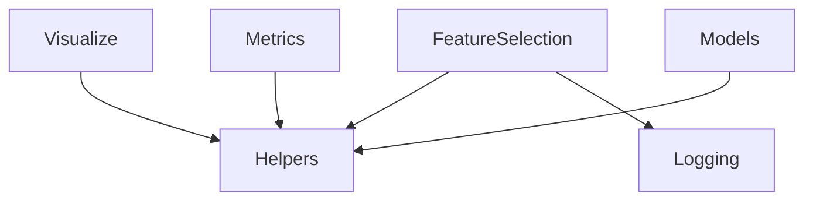

# Design Document

## Overview
**Purpose**: models 以外の公開 API（helpers・logging・metrics・feature_selection・visualize）に英語の docstring とテストを揃え、読んで見つかった小さな不具合を直す。
**Users**: yikit の作者と利用者。docs の API リファレンス（Sphinx が docstring から作る）を読む人。
**Impact**: 公開 API の名前と形はほぼ保つ。変わるのは、`yikit.metrics.root_mean_squared_error` の削除、`log_likelihood` が学習の `Score` によらず対数尤度を返すこと、FilterSelector の相関の判定（絶対値）、BorutaPy の乱数の扱いと `get_support(weak=True)`、`tqdm_joblib` の逐次実行での進捗（generator を返す `Parallel` は数えなくなる）、図の関数が落ちていた入力、`SummarizePI.get_data` の中身（あわせて `SummarizePI.get_figure` がばらつきを誤差棒で描く。以前は描こうとして NaN になっていた）。

### Goals
- 5つのサブパッケージの `__all__` のすべての名前が少なくとも1つのテストで使われ、（`yikit.logging` が再公開する標準ライブラリの定数を除いて）英語の numpy 形式の docstring を持つ
- 図の関数が正しい入力で落ちず、利用者の matplotlib の設定を変えない
- FilterSelector と BorutaPy が scikit-learn の決まり（`__init__` で引数を加工しない、`fit` で引数を書き換えない、`n_features_in_`）に従う

### Non-Goals
- ロガーの振る舞いの変更（1.0.0 で検討）
- models、公開していない関数（`calc_vip`、`is_correct_dist`）、docs のサイトの構成
- 新しい機能（`SummarizePI.get_data` と `tqdm_joblib` の逐次実行を除く）

## Boundary Commitments

### This Spec Owns
- `src/yikit/helpers/`、`src/yikit/logging/`、`src/yikit/metrics/`、`src/yikit/feature_selection/`、`src/yikit/visualize/` の公開 API の docstring・振る舞いの修正
- これらのテスト（`tests/test_helpers.py`・`test_logging.py`・`test_metrics.py`・`test_filtermethod.py`・`test_boruta.py`・`test_visualize.py`）と `tests/conftest.py` の英語化

### Out of Boundary
- `src/yikit/models/`（`yikit.helpers.is_installed` の契約だけは models が使うので変えない）
- ロガーの振る舞い（既定のハンドラを import で付けること、水準、propagate）
- BorutaPy の ensemble-on-sklearn で入れた振る舞い（`perc` の解決、`perc_`、`_transform`）の変更

### Allowed Dependencies
- 既存の依存だけ: numpy、pandas、scipy、scikit-learn（>=0.24.1）、joblib、matplotlib、seaborn。optional: tqdm、boruta、optuna、lightgbm、ngboost
- 依存の向き（structure.md）: helpers・logging は他に依存しない。metrics・feature_selection は基盤だけ。visualize は基盤と metrics（`log_likelihood` は使わないので、実際は基盤だけになる）。models には依存しない

### Revalidation Triggers
- `is_installed` の名前・引数・返り値（models と、それを置き換えるテスト）
- `yikit.metrics` の公開する名前（yikit の examples は `yikit.metrics.root_mean_squared_error` を使っていない。examples の simulate は scikit-learn の `mean_squared_error(..., squared=False)` を使い、新しい scikit-learn で落ちる。release-0.4.0 で書き直す）
- BorutaPy の引数と学習後の属性（ensemble-on-sklearn のテストと Examples）
- 図の見た目（参照画像）

## Architecture

### Architecture Pattern & Boundary Map
新しい構造は足さない。各サブパッケージの中で、関数とクラスを直す。共通の小さな関数を1つだけ helpers に足す（列名の取得）。

### Technology Stack
新しい依存はない。scikit-learn 0.24.1、Python 3.8 で動く API だけを使う。

## File Structure Plan

### Modified Files
- `src/yikit/helpers/_helpers.py` — `tqdm_joblib` を `Parallel.print_progress` の差し替えで作り直す。docstring の整理
- `src/yikit/helpers/_validation.py`（新規・非公開）— `feature_names_of(X)`: 列名がすべて `str` で scikit-learn 1.0 以上なら列名の配列、そうでなければ None
- `src/yikit/logging/_logging.py` — docstring、`catch_default_handler` の状態の戻し方、実行時の `assert` を明示的な検査に
- `src/yikit/metrics/__init__.py`・`_common.py`（削除）・`_ngboost.py` — `root_mean_squared_error` の削除、`log_likelihood` を学習の `Score` によらず対数尤度にする、docstring
- `src/yikit/feature_selection/_filter.py` — 絶対値の相関、反復による削除、`n_features_in_`・`feature_names_in_`、一定の列、クラスの docstring
- `src/yikit/feature_selection/_wrapper.py` — BorutaPy の `random_state` と表示の設定の扱い、`perc="auto"` のシャッフルの種、進捗バーの閉じ方、クラスの docstring
- `src/yikit/visualize/_yyplot.py`・`_permutation_importance.py`・`_optuna.py`・`_gbdt.py`・`_utils.py` — 図の不具合、フォントの戻し方、`get_data`、docstring、日本語のコメント
- `tests/` — `test_helpers.py`・`test_logging.py`・`test_metrics.py`（新規）、`test_filtermethod.py`・`test_boruta.py`・`test_visualize.py`（拡充）、`conftest.py`（英語化）。参照画像は必要なときだけ作り直す

## Components and Interfaces

| Component | Intent | Requirements |
|-----------|--------|--------------|
| Helpers | `is_installed`・`is_argument`・`dummy_tqdm`・`tqdm_joblib` | 1.1–1.5, 7.1 |
| Logging | ロガーの取得と既定のハンドラ | 2.1–2.5, 7.1 |
| Metrics | `log_likelihood`（`root_mean_squared_error` は削除） | 3.1–3.3, 7.1 |
| FilterSelector | 相関の強い特徴量を取り除く | 4.1–4.6, 7.1 |
| BorutaPy | Boruta による特徴量の選択 | 5.1–5.6, 7.1 |
| Visualize | 図の関数 | 6.1–6.7, 7.1 |
| Tests | テストと英語化 | 7.2–7.5 |

### Helpers（`src/yikit/helpers/`）
- `is_installed`・`is_argument`・`dummy_tqdm`: 振る舞いは変えない。docstring とテスト
- `tqdm_joblib(total, silent=False, **tqdm_kwargs)`:
  - `__enter__` で進捗バー（tqdm、なければ `dummy_tqdm`）を作り、`joblib.parallel.Parallel.__call__` と `Parallel.print_progress` を差し替える
  - 差し替えた `__call__`: context に入ったスレッドで、追っている呼び出しが走っていないときに始まった `Parallel` だけを「追う呼び出し」にする（中で動く別の `Parallel` の進捗を混ぜない）。`self.return_generator` が真の呼び出し（`return_as` が list 以外）は追わない（`__call__` が作業の前に戻るため。joblib 1.3 未満にはこの属性がないので、ないときは偽とみなす）。追う呼び出しは、始まるときに context とそのときの合計（`base`）をインスタンスに結び付ける。終わったら（例外のときも finally で）合計を `base + self.n_completed_tasks` にし、進捗バーをその値まで進めてから結び付けを外す
  - 差し替えた `print_progress`: インスタンスに context が結び付いていれば、進捗バーを `base + self.n_completed_tasks` まで進める（進めるだけで戻さない。同じ呼び出しで何度計算しても同じ値になる）。元の `print_progress` も呼ぶ。loky では `print_progress` が、`__call__` が戻った後や `__exit__` の後にもコールバック用のスレッドで呼ばれうる（loky の terminate はそのスレッドを待たない）。そのため結び付けは `print_progress` の初めに一度だけ読み、元の関数は差し替えのときに取っておいた参照（戻した後も消さない）で呼ぶ
  - `__exit__` で元の2つに戻し（例外のときも）、進捗バーを閉じる
  - 入れ子や、別々のスレッドでの同時の利用でも差し替えが正しく戻るよう、差し替えはモジュールに1つのロックと数で管理する（最初に入った context が差し替え、最後に出た context が戻す）。BorutaPy の `perc="auto"` は EnsembleRegressor をスレッドで並列にすると同時に呼ばれうるため
  - context の引き方: スレッドごとの context のスタック（入ったら積み、出たら外す。いちばん上が有効。入れ子では内側の context が数える）を引くのは、呼び出したスレッドで動く差し替えた `__call__` だけにする。そこで context をその `Parallel` のインスタンスに結び付け（終わったら外す）、差し替えた `print_progress` は `self`（インスタンス）から context を引く。joblib は並列のとき `print_progress` をコールバック用のスレッドで呼ぶので、スレッドから引くと進まないため。逐次実行の経路は呼び出したスレッドで動く
  - モジュールのロックは、差し替えと数の増減の間だけ持つ。元の `__call__` を呼んでいる間と `print_progress` の中では取らない（joblib は `print_progress` を自身のロックを持ったまま呼ぶので、デッドロックを避ける）。context ごとの小さなロックは、合計と進捗バーの読み書きの間だけ持ち、その中で joblib を呼ばない
- `_validation.feature_names_of(X) -> NDArray | None`（非公開）: `X.columns` の名前がすべて `type(name) is str`（`numpy.str_` を除く）で、scikit-learn 1.0 以上のときだけ `np.array(columns, dtype=object)`

### Logging（`src/yikit/logging/`）
- 振る舞いは変えない（2.1）。docstring に、import で既定のハンドラを付けること、水準 INFO、propagate False、止め方（`disable_default_handler`）を書く
- `catch_default_handler`: `__enter__` で既定のハンドラが付いているかを覚え、`__exit__` でその状態に戻す（2.4）
- `enable_default_handler`・`disable_default_handler` の `assert` を、明示的な検査と意味のある例外に置き換える（`python -O` でも同じ振る舞い）

### Metrics（`src/yikit/metrics/`）
- `_common.py` を消し、`__init__.py` は ngboost があるときだけ `log_likelihood` を公開する（`__all__` は空か `["log_likelihood"]`）
- `log_likelihood` は、学習の `Score` によらず平均の対数尤度（大きいほど良い）を返す（3.2。作者の判断）。`-estimator.score` は `Score=LogScore` のときだけ対数尤度になるため、予測した分布の対数尤度（回帰は `logpdf`、分類は正解のクラスの対数確率）の平均を計算する。`Score=LogScore` では今と同じ値。docstring もそれに合わせる（3.3）

### FilterSelector（`src/yikit/feature_selection/_filter.py`）
- `fit`: `check_array` の後、`n_features_in_` と `feature_names_of(X)`（あれば `feature_names_in_`）を入れる。相関行列と p 値は今と同じに計算し、`np.errstate` で一定の列の警告を抑え、NaN は相関なしとして扱う（4.5）
- 削除の判定は `|r| > self.r` かつ `p < self.alpha`（4.1）。今の再帰と同じ順番で特徴量を取り除く処理を、ループで書き直す（4.4。符号の扱いを除いて、選ぶ結果は今と同じ）
- クラスの docstring に Parameters・Attributes（`corr_`、`support_`、`n_features_in_`、`feature_names_in_`）・Examples（4.6）。`transform` と `get_feature_names_out` は `SelectorMixin` のまま（4.2、4.3）

### BorutaPy（`src/yikit/feature_selection/_wrapper.py`）
- `__init__` は引数を同じ名前の属性に入れるだけにする（5.1）。`_use_tqdm`・`_use_logging` は `_fit` の初めに `verbose` から決める（5.4）
- `_fit`: `rng = check_random_state(self.random_state)`。`perc_` を決め（`perc="auto"` なら `_calc_auto_perc(X, y, rng)`）、boruta の `_fit` の間だけ `self.perc = perc_`、`self.random_state = rng` にして、try/finally で両方を元に戻し、進捗バーが開いていれば閉じる（5.2、5.5）
- `_calc_auto_perc`: シャッフルごとの種を `rng` から先に引き、ワーカーには種を渡す（5.3）
- クラスの docstring（numpy 形式、`perc_`・`r_ccmax_`・`pears_` などの属性、Examples、References）と誤字（5.6）
- `get_support(weak=True)` は confirmed と tentative の両方（`support_ | support_weak_`）を返す。以前は tentative だけを返し、docstring と boruta の `transform(X, weak=True)` と食い違っていた（作者の判断。task 7 で見つかった）

### Visualize（`src/yikit/visualize/`）
- `set_font`: 全体の設定を変える関数として残し、docstring に書く
- `with_custom_matplotlib_settings`: そのまま（docstring の日本語のコメントを英語に）
- `SummarizePI`: クラスの docstring。`get_figure` を `with_custom_matplotlib_settings` で包む（6.1）。`get_data()` は、`get_figure` と同じ計算の値を DataFrame で返す（列は正規化した重要度の平均と標準偏差、行は特徴量、大きい順。6.6）
- `get_learning_curve_gb`: `with_custom_matplotlib_settings` で包む（6.1）。色は既知の名前（train・test・val）なら `COLORS`、それ以外は matplotlib の色の順。評価の記録が空なら ValueError、NGBoost・LightGBM 以外は TypeError（6.5）
- `get_learning_curve_optuna`: `TrialState.COMPLETE` の試行だけを使う。完了した試行がない、方向が `NOT_SET`、多目的の study は ValueError（6.4）
- `get_dist_figure`: `plt.subplots(..., squeeze=False)`。`titles` の既定を None にする。docstring を直す（6.3）
- `yyplot`: 指標の名前を描く前に検査する。`ax` を渡されたときは `tight_layout` をかけない。ラベルは数式の外に置くか、数式の特殊文字を逃がして、書いたとおりに表示する。RMSE は `mean_squared_error(..., multioutput="raw_values")` の平方根の平均で計算する（scikit-learn の RMSE の既定と同じで、多出力では出力ごとの RMSE の平均。6.2、3.1）

## Error Handling

| 状況 | 出すもの | 場所 |
|------|---------|------|
| `get_child_logger` の名前が yikit・`__main__` の外 | ValueError | logging |
| 既定のハンドラの状態が想定と違う | RuntimeError（今の `assert` の代わり） | logging |
| `log_likelihood` に NGBoost 以外 | TypeError | metrics |
| `log_likelihood` のモデルの分布に ngboost の LogScore の実装がない | ValueError（分布の名前を示す） | metrics |
| 学習時と違う数の特徴量で `transform` | ValueError（SelectorMixin） | FilterSelector |
| `yyplot` の未知の指標 | ValueError（描く前） | visualize |
| 完了した試行がない・方向がない・多目的の study | ValueError | visualize |
| 評価の記録がないモデル | ValueError | visualize |
| NGBoost・LightGBM 以外のモデル | TypeError | visualize |

## Testing Strategy
小さなデータを各テストファイルの中に置く（`conftest.py` の共通のデータは使ってよい）。optional の依存を使うテストは `pytest.importorskip` で飛ばし、モジュールの先頭で無条件に import しない（7.4）。

- `test_helpers.py`: `is_installed`（あるもの・ないもの）、`is_argument`、`dummy_tqdm`、`tqdm_joblib`（`n_jobs` = None・1・2 で進捗バーが単調に進み total に達する（loky ではバッチ単位で進んでよい）、中で別の `Parallel` を動かしても混ざらない、`return_as="generator"` の呼び出しは数えない（joblib 1.3 以上のときだけ）、抜けると差し替えが戻る、例外のときも戻る、`silent=True`）
- `test_logging.py`: `get_root_logger` の設定、`get_child_logger`（yikit の中、`__main__`、それ以外の ValueError）、`enable`・`disable` の重複なし、`catch_default_handler` が入る前の状態に戻す（付いていた・外れていた）、`get_handler`
- `test_metrics.py`: `root_mean_squared_error` が import できない、`log_likelihood`（NGBRegressor と NGBClassifier で予測した分布の平均の対数尤度、`Score=LogScore` では `-score` と等しく、`Score=CRPScore` でも対数尤度、ほかのモデルで TypeError。ngboost がなければ飛ばす）
- `test_filtermethod.py`: 負の相関の除去、`get_feature_names_out`（DataFrame と ndarray）、特徴量の数の違いの ValueError、1000 を超える削除、一定の列（警告なし）、正の相関での結果が今と同じ
- `test_boruta.py`: `get_params()["random_state"]` が渡した値のまま、同じインスタンスで2回学習して同じ結果、`n_jobs` を変えても同じ `perc_`、`set_params(verbose=...)` が効く、例外のとき進捗バーが閉じる
- `test_visualize.py`: `yyplot`（値、指標の文字、渡した ax の図の配置が変わらない、未知の指標で描く前に ValueError、特殊文字のラベル）、`set_font`・`with_custom_matplotlib_settings`（戻す・戻さない）、`SummarizePI.get_data`（値と順番）と `get_figure` のあとのフォントの設定、`get_dist_figure` の 1・2 サンプル、`get_learning_curve_optuna` の失敗した試行と ValueError、`get_learning_curve_gb` の LightGBM の既定の名前とフォントの設定の戻し、空の記録。optuna・lightgbm・ngboost は `importorskip`
- 既存の図のテストと参照画像は保つ。見た目が意図して変わるものだけ作り直す（6.7）
