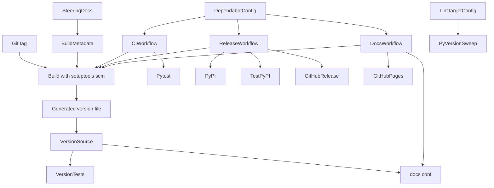
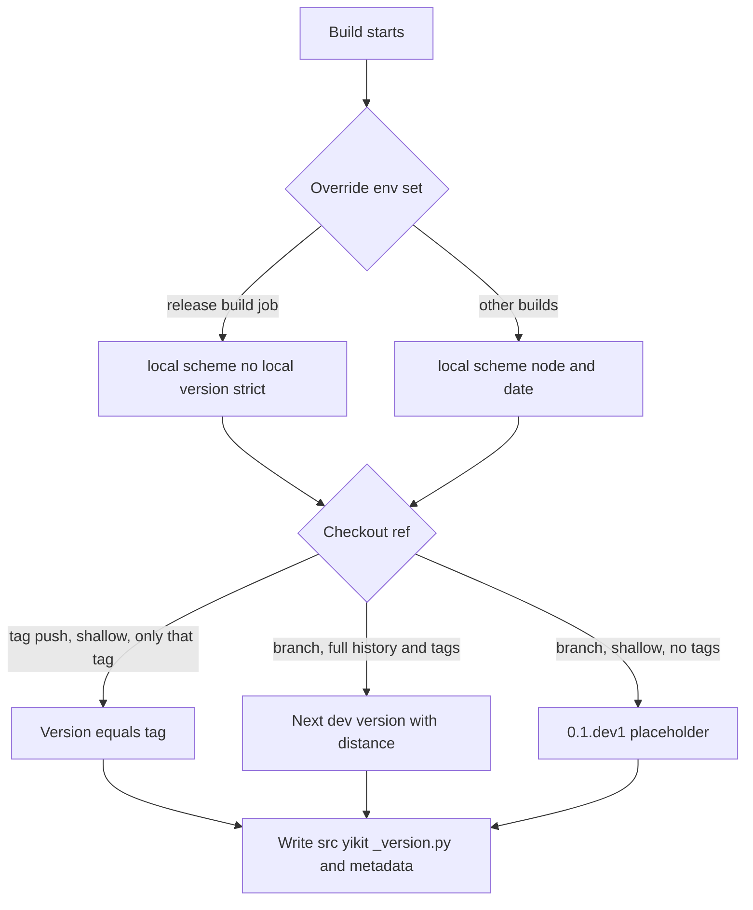
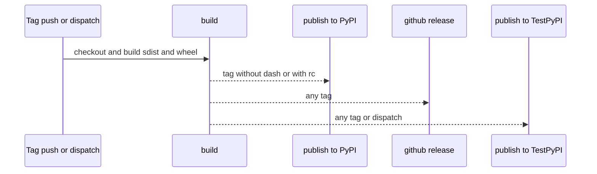

# Design Document: packaging-and-ci

## Overview
**Purpose**: yikit の作者が、0.5.0 から Python 3.10 以上だけを対象にし、tag を push するだけで正しい版番号の配布物を PyPI・TestPyPI・GitHub Release に出せるようにする。ビルドと workflow は作者の python-template にそろえる。
**Users**: yikit の作者（リリースとレビュー）、後に続く drop-legacy-compat と release-0.5.0、yikit を入れる利用者（licond など）。
**Impact**: 対応する Python は 3.8 以上から 3.10 以上になる。ライセンスは PEP 639 の式で宣言する。版番号は `src/yikit/__init__.py` に手で書くのをやめ、setuptools-scm が git の tag から決めて `src/yikit/_version.py` に書く。CI は Python 3.10〜3.14 を `ubuntu-latest` で回し、テストを飛ばす判定を job の中で行う。release は `concurrency` を持ち、手動実行で TestPyPI に開発版を出せる。ruff と mypy は 3.10 を対象にする。公開 API と計算の結果は変えない。

### Goals
- `requires-python = ">=3.10"`、classifiers は 3.10〜3.14、`typing_extensions` の依存なし
- `license = "Apache-2.0"`・`license-files` と `setuptools>=77.0.3` で、ライセンスの非推奨の警告なしにビルドできる
- tag `vX.Y.Z` から `X.Y.Z`、`vX.Y.Z-rc.N` から `X.Y.ZrcN` の配布物ができ、`yikit.__version__` がそれと同じ。版のファイルがなくても import できる
- CI・release・docs・dependabot が python-template の形になり、違う点はすべて理由がある
- 手元の ruff と mypy が 3.10 を対象にエラー 0 件で通る

### Non-Goals
- ライブラリの依存の下限・上限と、ライブラリの古い版のための分岐の削除（drop-legacy-compat）
- CHANGELOG、tag の作成、0.5.0 のリリース（release-0.5.0）
- 下限の版で試す CI の job、CI での ruff・mypy の実行
- PyPI・TestPyPI の trusted publishing の登録の変更、ブランチの保護や必須の checks の設定
- sdist の中身を絞ること（`MANIFEST.in`）

## Boundary Commitments

### This Spec Owns
- `pyproject.toml` のうち、`[build-system]`、`[project]` の `dynamic`・`requires-python`・`license`・`license-files`・`classifiers`、`dependencies` の `typing_extensions` の行の削除、`[tool.setuptools.dynamic]` の削除、`[tool.setuptools_scm]`
- 版番号の出どころ: `src/yikit/__init__.py` の `__version__` の読み方、生成される `src/yikit/_version.py`（追跡しない）、`.gitignore` のその行
- 版番号のテスト（`tests/test_version.py`）
- workflow: `.github/workflows/CI.yml`、`.github/workflows/release-pypi.yml`、`.github/workflows/docs.yml` と、`.github/dependabot.yml`
- 手元の検査の対象の版: `ruff.toml` の `target-version`、`mypy.ini` の `python_version`
- Python 3.8・3.9 向けの書き分けの削除: `src/yikit/helpers/_helpers.py`、`src/yikit/visualize/_yyplot.py`、`src/yikit/visualize/_utils.py` の import と注記
- steering の `tech.md` のうち、Core Technologies の Language の行、「型」、「コードの品質」、「テスト」の CI の項目、「Development Environment」、「Release」の節。README の Python の版の記述の確認

### Out of Boundary
- `pyproject.toml` の `dependencies`・`optional-dependencies` のライブラリの行（`typing_extensions` の行を除く）、ngboost の marker（drop-legacy-compat）
- ライブラリの版による分岐と、その注記・テスト（`NDArray` の `TYPE_CHECKING`、LightGBM・ngboost・seaborn・scikit-learn・optuna の分岐、`tests/test_visualize.py` の LightGBM 4.6 の注記など。drop-legacy-compat）
- `tech.md` の「互換性」と「Key Libraries」の節、Core Technologies の Framework・Core deps の行、`product.md`（drop-legacy-compat）
- CHANGELOG、tag、PyPI への公開、licond への連絡（release-0.5.0）
- `docs_src/conf.py`（`yikit.__version__` を読むので変えない）、`.github/release.yml`（リリースノートの分類。変えない）
- `dummy_tqdm` などの公開のクラスの定義（基底のクラスを含む）

### Allowed Dependencies
- ビルド: setuptools>=77.0.3、setuptools-scm>=10.1（依存の vcs-versioning を含む）。pip の build isolation で取得する
- GitHub Actions の部品: `actions/checkout@v7`、`actions/setup-python@v7`、`dorny/paths-filter@v4`、`actions/upload-artifact@v7`、`actions/download-artifact@v8`、`sigstore/gh-action-sigstore-python@v3.5.0`、`pypa/gh-action-pypi-publish@release/v1`、`peaceiris/actions-gh-pages@v4`
- 環境 `pypi`・`testpypi` の trusted publishing（今の登録のまま）
- 手元: yikit-dev（Python 3.12）の ruff 0.16 以上、mypy 2.4 以上、pytest、build 1.6.1、actionlint。setuptools-scm は作者の承認の後に入れる
- テストは標準ライブラリと pytest、`packaging`（pytest の依存）だけを使う

### Revalidation Triggers
- `requires-python` や CI の行列を変えたとき: drop-legacy-compat の下限の決め方（3.10 の job で入る版）を見直す
- `[tool.setuptools_scm]` や `__init__.py` の版の読み方を変えたとき: docs の `conf.py`、`tests/test_version.py`、release-0.5.0 の手順を確かめる
- release workflow の起動の条件や公開の条件を変えたとき: release-0.5.0 の手順と、PyPI・TestPyPI の trusted publishing の登録を確かめる
- workflow のファイル名を変えたとき: trusted publishing の登録と README のバッジを直す
- ruff の `target-version` や mypy の `python_version` を変えたとき: すべてのコードが新しい対象で通るか確かめる
- ブランチの保護で必須の checks を設定するとき: matrix の job を飛ばしたときの check の名前（Risks を参照）

## Architecture

### Existing Architecture Analysis
- 版番号は `src/yikit/__init__.py` の `__version__ = "0.4.0"` にあり、`[tool.setuptools.dynamic]` がそれを読む。docs の `conf.py` も `yikit.__version__` を読む
- CI は `on.*.paths` で起動を絞り、`ubuntu-24.04` で 3.8〜3.14 を回す。release は tag と手動実行で起動し、TestPyPI の job は手動実行でも走る（同じ版を 2 回出すと失敗する）
- dev-foundation が決めた点は保つ: `fail-fast: false`、`pip install ".[test,optional]"`、ruff の規則の固定、mypy の `files`、dependabot の `increase-if-necessary`
- 詳細は `research.md` の「今のファイルの状態」

### Architecture Pattern & Boundary Map



**Architecture Integration**:
- Selected pattern: 版番号の真実の出どころは git の tag だけにし、ビルドのときに 1 回だけ決めて `_version.py` と配布物のメタデータの両方に書く。workflow は「どの ref でビルドするか」と「どこに出すか」だけを決める
- Domain/feature boundaries: ビルドの宣言（BuildMetadata）、版の読み方（VersionSource・VersionTests）、workflow（CI・Release・Docs・Dependabot）、lint の対象（LintTargetConfig・PyVersionSweep）、steering（SteeringDocs）の 5 つに分かれ、互いのファイルを共有しない
- 依存の向き: BuildMetadata → VersionSource → VersionTests。workflow は BuildMetadata のビルドの仕方に依存し、逆はない。SteeringDocs は他のすべてを記述するだけで、何からも参照されない
- Existing patterns preserved: src レイアウト、`[test,optional]` の extra で CI に入れる方式、`pytest -ra`、ruff の規則の固定、`concurrency`（CI は cancel-in-progress: true）
- Steering compliance: 公開 API を変えない、ruff・mypy は手元、依存の下限は drop-legacy-compat に任せる

### Technology Stack

| Layer | Choice / Version | Role in Feature | Notes |
|-------|------------------|-----------------|-------|
| Build | setuptools>=77.0.3、setuptools-scm>=10.1（最新は 10.3.4、vcs-versioning 2.6.0） | PEP 639 のライセンス、tag からの版、`_version.py` の生成 | python-template は `setuptools-scm[toml]>=7`。違いは後述 |
| Runtime | Python 3.10〜3.14 | 対応する版 | 3.10 のサポートは 2026-10-31 に終わるが残す（作者の決定） |
| CI | GitHub Actions、`ubuntu-latest`（今は 24.04）、`dorny/paths-filter@v4` | テストと判定 | setup-python は 3.10〜3.14 を 22.04・24.04・26.04 に配っている |
| Release | `pypa/gh-action-pypi-publish@release/v1`、`sigstore/gh-action-sigstore-python@v3.5.0`、`gh release` | 公開と署名 | trusted publishing（`pypi`・`testpypi`） |
| Lint / Type（手元） | ruff 0.16 以上（`target-version = "py310"`）、mypy 2.4 以上（`python_version = 3.10`） | 3.10 を対象にした検査 | CI では走らせない |
| Workflow の検査（手元） | actionlint 1.7.12 | workflow の構文と shellcheck | 今の release workflow には SC2086 の指摘が 2 件ある |

## File Structure Plan

### Modified Files
- `pyproject.toml`（BuildMetadata） — `[build-system] requires = ["setuptools>=77.0.3", "setuptools-scm>=10.1"]`。`requires-python = ">=3.10"`。`license = "Apache-2.0"` と `license-files = ["LICEN[CS]E*"]`（3.8 のためのコメントを消す）。classifiers を 3.10〜3.14 に。`dependencies` の `typing_extensions` の行を消す（他の行は触らない）。`[tool.setuptools.dynamic]` を消す。`[tool.setuptools_scm]` を足す
- `src/yikit/__init__.py`（VersionSource） — `__version__ = "0.4.0"` を、`_version.py` があれば読み、なければ `"unknown"` にする形に置き換える。docstring と `__license__`・`__author__`・`__copyright__` は残す
- `.gitignore`（VersionSource） — `src/yikit/_version.py` を足す
- `.github/workflows/CI.yml`（CIWorkflow） — `permissions`、`changes` job、`test` job（`needs`・`if`、`ubuntu-latest`、3.10〜3.14、`fail-fast: false`、`pytest -ra`）、actions を新しい版に。`on.*.paths` と runner の固定のコメントを消す
- `.github/workflows/release-pypi.yml`（ReleaseWorkflow） — python-template の `release.yml` の形に（`concurrency`、`permissions`、`PUBLISH_PYPI`・`PYPI_PACKAGE_NAME`、outputs、公開の条件）。build の checkout の `fetch-depth` の切り替えと、ローカル版を外す `env`。TestPyPI は手動実行でも出し、手動実行では `skip-existing`。`$GITHUB_OUTPUT` を引用符で囲む。ファイル名は変えない
- `.github/workflows/docs.yml`（DocsWorkflow） — actions を新しい版に。checkout の `fetch-depth` を release と同じ式にし、`fetch-tags` を消す
- `.github/dependabot.yml`（DependabotConfig） — github-actions の項目（週ごと、`chore: `、上限 5、`groups` で 1 つの PR）を足す。pip の項目は変えない
- `ruff.toml`（LintTargetConfig） — `target-version = "py310"`
- `mypy.ini`（LintTargetConfig） — `python_version = 3.10`
- `src/yikit/helpers/_helpers.py`（PyVersionSweep） — `sys.version_info` の分岐を `from collections.abc import Callable, Iterable, Iterator` にし、使われなくなる `import sys` と `# HACK: when drop python3.8 ...` の注記を消す
- `src/yikit/visualize/_yyplot.py`（PyVersionSweep） — `sys.version_info` の分岐を `from collections.abc import Sequence` にし、`import sys` を消す。`NDArray` の注記には触らない
- `src/yikit/visualize/_utils.py`（PyVersionSweep） — `Callable` を `collections.abc` から import する
- `.kiro/steering/tech.md`（SteeringDocs） — SteeringDocs に書いた節だけを直す（実装のタスクで行う）。`README.md` は確かめるだけ

### New Files
- `tests/test_version.py`（VersionTests） — `yikit.__version__` が生成された版のファイルと一致すること、版のファイルがないと `"unknown"` になること

### Generated Files（git で追跡しない）
- `src/yikit/_version.py` — setuptools-scm がビルドとインストールのときに書く。`.gitignore` で外す。ruff は gitignore を尊重するので検査しない。mypy は `files = src/yikit` で読む（生成される中身は注釈つきで 3.10 で通る）

### Unchanged Files（確かめた）
- `docs_src/conf.py` — インストールした yikit の `__version__` を読むので変えない
- `README.md` — Python の版を書いた文がない。PyPI の pyversions のバッジは classifiers から作られる
- `.github/release.yml`、`.python-version`（3.12.8。release と docs の Python に使われる）

## System Flows

### 版番号が決まる流れ



- tag の push（release・docs）では浅い clone なので、同じコミットに他の tag があっても push された tag の版になる（5.4、6.2）
- tag ではない ref の手動実行（release・docs）では全履歴と tag を取るので、最後の tag からの距離で開発版になる（3.3）。release では上書きの環境変数でローカル版を外す（5.5）
- CI の test job は浅い clone なので仮の版（`0.1.dev1+g<hash>`）になる。テストは版の値に依存しない

### release workflow の job



- `concurrency` は `${{ github.workflow }}-${{ github.ref }}` で、`cancel-in-progress: false`（5.7）
- 手動実行（tag ではない ref）では PyPI と GitHub Release の job は飛ばされ、TestPyPI だけが走る（5.5）

## Requirements Traceability

| Requirement | Summary | Components | Interfaces | Flows |
|-------------|---------|------------|------------|-------|
| 1.1 | 3.10 以上を宣言 | BuildMetadata | `requires-python` | — |
| 1.2 | classifiers 3.10〜3.14 | BuildMetadata | classifiers | — |
| 1.3 | 3.9 以下では選ばれない | BuildMetadata | `Requires-Python` のメタデータ | — |
| 1.4 | `typing_extensions` を宣言しない | BuildMetadata | `dependencies` | — |
| 1.5 | 3.8・3.9 の書き分けを持たない | PyVersionSweep | import の書き換え、注記の削除 | — |
| 2.1 | SPDX の式で宣言 | BuildMetadata | `license` | — |
| 2.2 | LICENSE を含み、メタデータに示す | BuildMetadata | `license-files`、`License-Expression`・`License-File` | — |
| 2.3 | 式を受け付ける版のビルドの道具を求める | BuildMetadata | `[build-system] requires` | — |
| 2.4 | ライセンスの非推奨の警告なし | BuildMetadata | 手元のビルドの確認 | — |
| 3.1 | `vX.Y.Z` から `X.Y.Z` | BuildMetadata、ReleaseWorkflow | `[tool.setuptools_scm]`、checkout | 版番号が決まる流れ |
| 3.2 | `vX.Y.Z-rc.N` から `X.Y.ZrcN` | BuildMetadata、ReleaseWorkflow | 既定の tag の正規表現と PEP 440 の正規化 | 版番号が決まる流れ |
| 3.3 | tag の後は開発版 | BuildMetadata | `guess-next-dev` | 版番号が決まる流れ |
| 3.4 | `__version__` が入れた版と同じ | VersionSource、VersionTests | `_version.py`、`__version__` | — |
| 3.5 | 版のファイルがなくても import できる | VersionSource、VersionTests | `"unknown"` | — |
| 3.6 | 版のファイルを追跡しない | VersionSource | `.gitignore` | — |
| 3.7 | 版を手で書かない | VersionSource、BuildMetadata | `[tool.setuptools.dynamic]` の削除 | — |
| 4.1 | 変更の判定 | CIWorkflow | `changes` job、paths-filter | — |
| 4.2 | 3.10〜3.14 でテスト | CIWorkflow | `test` job の行列 | — |
| 4.3 | 手動実行では必ずテスト | CIWorkflow | `if` の `workflow_dispatch` | — |
| 4.4 | 飛ばしても成功で完了 | CIWorkflow | job の `if`（`on.paths` を使わない） | — |
| 4.5 | 他の版を止めず全体は失敗 | CIWorkflow | `fail-fast: false` | — |
| 4.6 | 読む権限だけ | CIWorkflow | `permissions` | — |
| 4.7 | runner を固定しない | CIWorkflow | `runs-on: ubuntu-latest` | — |
| 4.8 | ruff・mypy を実行しない | CIWorkflow | job を置かない | — |
| 5.1 | 正式版の公開 | ReleaseWorkflow | 公開の条件 | release workflow の job |
| 5.2 | rc の公開 | ReleaseWorkflow | 公開の条件、pre-release の判定 | release workflow の job |
| 5.3 | rc 以外の `-` は PyPI に出さない | ReleaseWorkflow | 公開の条件 | release workflow の job |
| 5.4 | 同じコミットの tag でも push された版 | ReleaseWorkflow | build の checkout（tag は浅く） | 版番号が決まる流れ |
| 5.5 | 手動実行は開発版を TestPyPI だけに | ReleaseWorkflow | checkout（全履歴）、上書きの `env`、`if` | 版番号が決まる流れ |
| 5.6 | 同じ版は飛ばす | ReleaseWorkflow | `skip-existing` | — |
| 5.7 | 実行中を取り消さない | ReleaseWorkflow | `concurrency` | release workflow の job |
| 5.8 | 権限は job ごと | ReleaseWorkflow | `permissions` | — |
| 5.9 | trusted publishing の登録のまま | ReleaseWorkflow | ファイル名、`environment.name` | — |
| 6.1 | 正式版の tag で docs | DocsWorkflow | 起動の条件、`conf.py` の `release` | 版番号が決まる流れ |
| 6.2 | 同じコミットの rc でも正式版の版 | DocsWorkflow | checkout（tag は浅く、`fetch-tags` なし） | 版番号が決まる流れ |
| 7.1 | 最新の major の部品 | CIWorkflow、ReleaseWorkflow、DocsWorkflow | `uses:` の版 | — |
| 7.2 | GitHub Actions の更新を 1 つの PR に | DependabotConfig | `groups` | — |
| 7.3 | pip の方針を変えない | DependabotConfig | `versioning-strategy` | — |
| 8.1 | ruff が 3.10 で 0 件 | LintTargetConfig、PyVersionSweep | `target-version = "py310"` | — |
| 8.2 | mypy が 3.10 で 0 件 | LintTargetConfig | `python_version = 3.10` | — |
| 8.3 | ライブラリの書き分けは変えない | PyVersionSweep | 書き換えの範囲 | — |
| 9.1 | 公開 API を変えない | PyVersionSweep、VersionSource | 書き換えの範囲 | — |
| 9.2 | 同じ結果 | PyVersionSweep | 既存のテスト | — |
| 9.3 | wheel のモジュールが同じ | BuildMetadata | 手元のビルドの確認 | — |
| 10.1 | tech.md を 0.5.0 に | SteeringDocs | 節の書き換え | — |
| 10.2 | 互換性・Key Libraries・product.md を変えない | SteeringDocs | 書き換えの範囲 | — |
| 10.3 | README の Python の版 | SteeringDocs | README の確認（記述なし） | — |
| 11.1 | 入れるときは承認 | — | 手元のビルドの確認の手順 | — |
| 11.2 | TestPyPI の手動実行は確認 | ReleaseWorkflow | 手動実行の確認の手順 | — |
| 11.3 | tag・リリース・docs の手動実行をしない | DocsWorkflow、ReleaseWorkflow | 確認の手順 | — |

## Components and Interfaces

| Component | Domain/Layer | Intent | Req Coverage | Key Dependencies (P0/P1) | Contracts |
|-----------|--------------|--------|--------------|--------------------------|-----------|
| BuildMetadata | ビルドの宣言 | Python の版、ライセンス、ビルドの要件、版の決め方を宣言する | 1.1–1.4, 2.1–2.4, 3.1–3.3, 3.7, 9.3 | setuptools（P0）、setuptools-scm（P0） | State |
| VersionSource | 版の読み方 | `yikit.__version__` を生成された版のファイルから読む | 3.4–3.7, 9.1 | BuildMetadata（P0） | Service |
| VersionTests | テスト | 版の読み方と、版のファイルがないときの値を確かめる | 3.4, 3.5 | VersionSource（P0） | — |
| CIWorkflow | workflow | 変更を判定し、3.10〜3.14 でテストする | 4.1–4.8, 7.1 | GitHub Actions（P0）、paths-filter（P1） | Batch |
| ReleaseWorkflow | workflow | tag と手動実行でビルドして公開する | 3.1, 3.2, 5.1–5.9, 7.1, 11.2, 11.3 | BuildMetadata（P0）、trusted publishing（P0） | Batch |
| DocsWorkflow | workflow | 正式版の tag で docs を作って公開する | 6.1, 6.2, 7.1, 11.3 | BuildMetadata（P0）、`docs_src/conf.py`（P1） | Batch |
| DependabotConfig | workflow | pip と GitHub Actions の更新の提案 | 7.2, 7.3 | dependabot（P1） | State |
| LintTargetConfig | 手元の検査 | ruff と mypy の対象を 3.10 にする | 8.1, 8.2 | ruff（P0）、mypy（P0） | State |
| PyVersionSweep | コード | 3.8・3.9 のための import と注記を消す | 1.5, 8.1, 8.3, 9.1, 9.2 | LintTargetConfig（P0） | — |
| SteeringDocs | steering | tech.md を 0.5.0 に合わせ、README を確かめる | 10.1–10.3 | 他のすべて（P1） | — |

### ビルドの宣言

#### BuildMetadata

| Field | Detail |
|-------|--------|
| Intent | `pyproject.toml` のビルドと Python の版とライセンスと版の決め方の宣言 |
| Requirements | 1.1, 1.2, 1.3, 1.4, 2.1, 2.2, 2.3, 2.4, 3.1, 3.2, 3.3, 3.7, 9.3 |

**Responsibilities & Constraints**
- `[build-system]`: `requires = ["setuptools>=77.0.3", "setuptools-scm>=10.1"]`、`build-backend = "setuptools.build_meta"`
- `[project]`
  - `dynamic = ["version"]`（今のまま）
  - `requires-python = ">=3.10"`
  - `license = "Apache-2.0"`、`license-files = ["LICEN[CS]E*"]`。表の形と 3.8 のためのコメントを消す
  - classifiers: `"Programming Language :: Python :: 3"` と 3.10・3.11・3.12・3.13・3.14
  - `dependencies` から `"typing_extensions >= 4.5; python_version < '3.10'"` を消す。他の行（scikit-learn など）は drop-legacy-compat が触るので、この spec では変えない
- `[tool.setuptools.dynamic]`（`version = { attr = "yikit.__version__" }`）を消す。残すと setuptools-scm と版の出どころが 2 つになる
- `[tool.setuptools_scm]`:
  ```toml
  [tool.setuptools_scm]
  version_file = "src/yikit/_version.py"
  write_to_source = true
  ```
  tag の設定（`tag.prefix`・`tag.regex`）は置かない（既定の正規表現で `v0.5.0-rc.1` が `0.5.0rc1` になる）。`fallback_version` も置かない

**Contracts**: State [x]
- tag と版の対応: `vX.Y.Z` → `X.Y.Z`、`vX.Y.Z-rc.N` → `X.Y.ZrcN`、`vX.Y.Z-beta.N` → `X.Y.ZbN`。tag の後の N コミット目は `X.Y.(Z+1).devN+g<hash>`（rc の後は `X.Y.Zrc(N+1).devM+g<hash>`）
- 配布物のメタデータ: `Metadata-Version: 2.4`、`License-Expression: Apache-2.0`、`License-File: LICENSE`、`Requires-Python: >=3.10`
- wheel の中身: 今の `.py` のモジュールに `yikit/_version.py` と `.dist-info/licenses/LICENSE` が加わるだけ（`src/yikit` で追跡しているのは `.py` だけ）
- sdist の中身: git で追跡しているすべてのファイルと、`PKG-INFO`・`src/yikit/_version.py`

**Implementation Notes**
- Integration: `[tool.setuptools.dynamic]` の削除と VersionSource の変更は同じコミットに入れる（片方だけだと版の出どころが食い違う）
- Validation: 手元のビルドの確認（Testing Strategy）で、tag ごとの版、メタデータ、警告、wheel の中身を確かめる
- Risks: git の情報も PKG-INFO もない場所ではビルドが失敗する（`fallback_version` を置かない。誤った版の配布物を作らないため）

### 版の読み方

#### VersionSource

| Field | Detail |
|-------|--------|
| Intent | `yikit.__version__` を生成された `_version.py` から読み、なければ `"unknown"` にする |
| Requirements | 3.4, 3.5, 3.6, 3.7, 9.1 |

**Responsibilities & Constraints**
- `src/yikit/__init__.py` は python-template と同じ形にする:
  ```python
  from __future__ import annotations

  from pathlib import Path

  # setuptools-scm writes ``_version.py`` from the git tag when the package
  # is built or installed; a source tree that was never installed lacks it.
  _version_file = Path(__file__).parent / "_version.py"

  if _version_file.is_file():
      from ._version import __version__
  else:
      __version__ = "unknown"
  ```
- 例外を握りつぶさない: `try/except ImportError` ではなく、ファイルの有無で分ける（`_version.py` の中の誤りを隠さない）
- `.gitignore` に `src/yikit/_version.py` を足す（setuptools-scm の docs の勧めどおり、場所を限って書く）
- `yikit` の最上位には `__all__` がなく、公開 API はサブパッケージにある。`Path` と `_version_file` が最上位の名前に加わるが、公開 API ではない（python-template と同じ）

**Contracts**: Service [x]

##### Service Interface
```python
# yikit/__init__.py
__version__: str  # yikit._version.__version__ when the file exists, else "unknown"

# yikit/_version.py (generated by setuptools-scm, not tracked)
version: str
__version__: str
version_tuple: tuple[int | str, ...]
__version_tuple__: tuple[int | str, ...]
commit_id: str | None
__commit_id__: str | None
```
- Preconditions: なし（import に git も PKG-INFO も要らない）
- Postconditions: インストールした yikit では `__version__ == yikit._version.__version__` で、PEP 440 の版。版のファイルがないときは `"unknown"`
- Invariants: 版番号はソースのどこにも手で書かない

**Implementation Notes**
- Validation: VersionTests。手元の editable の環境は、setuptools-scm を入れて入れ直すまで `"unknown"` になる（Migration Strategy）
- Risks: 手元の最上位に古い `yikit.egg-info`（0.3.15）があり、`importlib.metadata` が誤った版を返すので、版の比較に `importlib.metadata` を使わない

#### VersionTests

| Field | Detail |
|-------|--------|
| Intent | `tests/test_version.py` で、版の読み方の 2 つの道筋を確かめる |
| Requirements | 3.4, 3.5 |

- `test_version_comes_from_generated_file`（名前は目安）: インストールした `yikit` の隣に `_version.py` があり、`yikit.__version__ == yikit._version.version` で、`packaging.version.Version(yikit.__version__)` が通る。`_version.py` がないときは、入れ直し（`pip install -e .`）を案内するメッセージで失敗する
- `test_version_falls_back_without_version_file`: インストールした `yikit/__init__.py` を `tmp_path` の別名のパッケージに写し、`importlib.util.spec_from_file_location` で読み込むと、`__version__ == "unknown"` で import に失敗しない
- 英語の docstring とコメントで書く（`test_public_api.py` の決まりに合わせる）

### workflow

#### CIWorkflow

| Field | Detail |
|-------|--------|
| Intent | 変更を判定し、テストに関わる変更があれば Python 3.10〜3.14 でテストする |
| Requirements | 4.1, 4.2, 4.3, 4.4, 4.5, 4.6, 4.7, 4.8, 7.1 |

**Contracts**: Batch [x]

##### Batch / Job Contract
- Trigger: `workflow_dispatch`、main への `push`、`pull_request`（opened・synchronize・reopened・ready_for_review）。`on` に `paths` を書かない（4.4）
- Workflow: `name: CI`、`run-name` と `concurrency`（cancel-in-progress: true）は今のまま。`permissions: contents: read`（4.6）
- `changes` job: `runs-on: ubuntu-latest`、`permissions: contents: read, pull-requests: read`、`outputs.code`。`actions/checkout@v7`（`fetch-depth: 0`。push のときに直前のコミットと比べるため）。`dorny/paths-filter@v4`（`id: filter`、`if: github.event_name != 'workflow_dispatch'`）。filter `code` は今の `on.paths` と同じ一覧（`src/**`、`**/*.py`、`tests/**`、`packages/**`、`.github/workflows/CI.yml`、`pyproject.toml`、`setup.py`、`setup.cfg`、`requirements*.txt`、`tox.ini`）（4.1）
- `test` job: `needs: changes`、`if: needs.changes.outputs.code == 'true' || github.event_name == 'workflow_dispatch'`（4.3、4.4）。`runs-on: ubuntu-latest`（4.7）。`strategy.fail-fast: false`、`matrix.python-version: ["3.10", "3.11", "3.12", "3.13", "3.14"]`（4.2、4.5）。`actions/checkout@v7`（既定の浅い clone）、`actions/setup-python@v7`、`pip install ".[test,optional]"`、`pytest -ra`
- ruff・mypy の job は置かない（4.8）
- Output: 版ごとの job の成否。飛ばしたときは `test` が skipped として報告され、実行は成功で終わる

**Implementation Notes**
- Validation: actionlint の指摘 0 件。`on` に `paths` がなく、`test` job に `if` がある（4.1、4.4 の静的な確認）。作業ブランチでの手動実行で 5 つの版が通る。テストを飛ばす判定は PR の差分全体を比べるのでマージの前には観察できず、main に入った後、コード以外だけを変える push で `test` が飛ばされ実行が成功になることを、作者か release-0.5.0 が確かめる（この spec のタスクにはしない）
- Risks: test job の setuptools-scm は浅い clone の警告を出し、仮の版になる（テストは版の値に依存しない）

#### ReleaseWorkflow

| Field | Detail |
|-------|--------|
| Intent | tag の push で PyPI・TestPyPI・GitHub Release に出し、手動実行で TestPyPI に開発版を出す |
| Requirements | 3.1, 3.2, 5.1, 5.2, 5.3, 5.4, 5.5, 5.6, 5.7, 5.8, 5.9, 7.1, 11.2, 11.3 |

**Contracts**: Batch [x]

##### Batch / Job Contract
- File: `.github/workflows/release-pypi.yml`（名前は変えない。5.9）
- Trigger: `workflow_dispatch`、tag の push（`v[0-9]+.[0-9]+.[0-9]+`、`v[0-9]+.[0-9]+.[0-9]+-*`）
- Workflow: `concurrency: { group: ${{ github.workflow }}-${{ github.ref }}, cancel-in-progress: false }`（5.7）。`env: { PUBLISH_PYPI: "true", PYPI_PACKAGE_NAME: "yikit" }`。`permissions: contents: read`（5.8）
- `build` job:
  - `outputs`: `publish_pypi`、`package_name`（`check` の step で `env` を `"$GITHUB_OUTPUT"` に書く）
  - `env`: `SETUPTOOLS_SCM_OVERRIDES_FOR_YIKIT: '{local_scheme = "no-local-version-strict"}'`（5.5。追跡しているファイルに変更があればビルドを失敗させる）
  - `actions/checkout@v7` に `fetch-depth: ${{ startsWith(github.ref, 'refs/tags/') && 1 || 0 }}`（tag は push された tag だけを浅く。それ以外は全履歴と全 tag。5.4、5.5）
  - `actions/setup-python@v7`（版は `.python-version`）、`pip install ".[dev]"`、`python3 -m build`、`actions/upload-artifact@v7`（`python-package-distributions`）
- `publish-to-pypi` job: `if: startsWith(github.ref, 'refs/tags/') && (!contains(github.ref_name, '-') || contains(github.ref_name, 'rc')) && needs.build.outputs.publish_pypi == 'true'`。`environment: { name: pypi, url: https://pypi.org/p/${{ needs.build.outputs.package_name }} }`。`permissions: id-token: write`。`actions/download-artifact@v8`、`pypa/gh-action-pypi-publish@release/v1`（5.1、5.2、5.3）
- `github-release` job: `if: startsWith(github.ref, 'refs/tags/')`。`permissions: contents: write, id-token: write`。`actions/download-artifact@v8`、`sigstore/gh-action-sigstore-python@v3.5.0`、tag に `-` を含めば pre-release（`"$GITHUB_OUTPUT"`）、`gh release create --generate-notes`、`gh release upload`（5.1、5.2、5.3）
- `publish-to-testpypi` job: `if: needs.build.outputs.publish_pypi == 'true' && (startsWith(github.ref, 'refs/tags/') || github.event_name == 'workflow_dispatch')`。`environment: { name: testpypi, url: https://test.pypi.org/p/${{ needs.build.outputs.package_name }} }`。`permissions: id-token: write`。`pypa/gh-action-pypi-publish@release/v1` に `repository-url: https://test.pypi.org/legacy/` と `skip-existing: ${{ github.event_name == 'workflow_dispatch' }}`（5.6）
- Idempotency & recovery: tag の push の 2 回目（同じ版）は PyPI・TestPyPI で失敗する（版を使い直せないため、意図どおり）。手動実行の 2 回目は TestPyPI で飛ばされる。失敗した job は GitHub の「Re-run failed jobs」でやり直す

**Implementation Notes**
- Validation: actionlint の指摘 0 件。作者の確認を得てから、作業ブランチで手動実行し、build の版がローカル版を含まない開発版であること、TestPyPI に出たこと、PyPI と GitHub Release の job が飛ばされたことを確かめる（11.2）。tag の push での確認は release-0.5.0 が行う（11.3）
- Risks: TestPyPI の trusted publishing が手動実行で通るかは、手動実行したことがないので未確認。失敗したら作者が TestPyPI の設定を見直す

#### DocsWorkflow

| Field | Detail |
|-------|--------|
| Intent | 正式版の tag で、その版番号の docs を作って GitHub Pages に出す |
| Requirements | 6.1, 6.2, 7.1, 11.3 |

**Contracts**: Batch [x]

##### Batch / Job Contract
- Trigger と `permissions: contents: write` は今のまま（正式版の tag と手動実行）
- `actions/checkout@v7` に `ref: ${{ github.ref }}` と `fetch-depth: ${{ startsWith(github.ref, 'refs/tags/') && 1 || 0 }}`。`fetch-tags` は書かない（浅い clone でもすべての tag を取ってしまうため。6.2）
- `actions/setup-python@v7`、`pip install ".[docs,optional]"`、`sphinx-apidoc`、`sphinx-build`、`peaceiris/actions-gh-pages@v4` は今のまま。`docs_src/conf.py` はインストールした yikit の `__version__` を `release` に使う（6.1）

**Implementation Notes**
- Validation: actionlint の指摘 0 件。docs の手動実行は公開中の docs を書き換えるので、この spec では行わない（11.3）。正式版の tag での確認は release-0.5.0 の v0.5.0 で行う
- Risks: `sphinx-apidoc` は `_` で始まるモジュールを既定で出さないので、`_version.py` は API リファレンスに出ない

#### DependabotConfig

| Field | Detail |
|-------|--------|
| Intent | GitHub Actions の更新を 1 つの PR にまとめて提案させる |
| Requirements | 7.2, 7.3 |

**Contracts**: State [x]
- pip の項目は変えない（`versioning-strategy: increase-if-necessary`、週ごと、`chore: `、上限 5）（7.3）
- 追加: `package-ecosystem: "github-actions"`、`directory: "/"`、`schedule.interval: "weekly"`、`commit-message.prefix: "chore: "`、`open-pull-requests-limit: 5`、`groups: { github-actions: { patterns: ["*"] } }`（7.2）

### 手元の検査

#### LintTargetConfig

| Field | Detail |
|-------|--------|
| Intent | ruff と mypy の対象を Python 3.10 にする |
| Requirements | 8.1, 8.2 |

**Contracts**: State [x]
- `ruff.toml`: `target-version = "py310"`。他の設定（`select`、`required-imports`、`extend-exclude`、`force-exclude`、行の長さ）は変えない
- `mypy.ini`: `python_version = 3.10` を足す。`files = src/yikit`、`ignore_missing_imports = True` は変えない

#### PyVersionSweep

| Field | Detail |
|-------|--------|
| Intent | Python 3.8・3.9 のためだけの書き分けを、振る舞いを変えずに消す |
| Requirements | 1.5, 8.1, 8.3, 9.1, 9.2 |

**Responsibilities & Constraints**
- ruff の UP035・UP036 の修正（UP036 は unsafe の修正）で、次の 3 つを直す
  - `src/yikit/helpers/_helpers.py`: `from collections.abc import Callable, Iterable, Iterator`
  - `src/yikit/visualize/_yyplot.py`: `from collections.abc import Sequence`
  - `src/yikit/visualize/_utils.py`: `from collections.abc import Callable` と `from typing import TypeVar`
- 使われなくなった `import sys`（`_helpers.py`、`_yyplot.py`）を手で消す（F401 は unfixable）
- `_helpers.py` の `# HACK: when drop python3.8, use dummy_tqdm(Iterable[T])` の注記を消す。`class dummy_tqdm(Iterable, Generic[T])` は変えない（`Iterable[T]` だけにすると MRO から `Generic` が外れる）
- ライブラリの版による書き分けと注記（`_yyplot.py` の `NDArray` の注記など）には触らない（8.3）
- 3.10 で今使っている import の先は変わらない（`_helpers.py`・`_yyplot.py` は今も `collections.abc` の側を通る）。`_utils.py` の `TypeVar` の bound は型検査のための値

**Implementation Notes**
- Validation: `ruff check src tests`、`ruff format --check src tests`、`mypy` がエラー 0 件。`pytest` の全体が変更の前と同じ結果（9.2）。`grep` で `src` と `tests` に `sys.version_info` がない

### steering

#### SteeringDocs

| Field | Detail |
|-------|--------|
| Intent | `tech.md` の該当の節を 0.5.0 に合わせ、README を確かめる |
| Requirements | 10.1, 10.2, 10.3 |

**Responsibilities & Constraints**
- Core Technologies の Language: Python 3.10 以上（`requires-python = ">=3.10"`）、CI で 3.10〜3.14、3.8・3.9 の環境は 0.4.x の系列が受け持つ
- 型: 「実行時に評価される場所では PEP 585/604 を使わない（3.8 対策）」を消す。`cast` は、`TYPE_CHECKING` の中で import した型を使うときに文字列で書く。mypy の項目を `python_version = 3.10` に直し、3.8 の説明を消す
- コードの品質: ruff の対象を Python 3.10 に
- テスト: CI の項目を、`ubuntu-latest`、3.10〜3.14、`changes` job で変更を判定してテストを飛ばす（飛ばしても成功）、`permissions` は読み取りだけ、に直す。runner の固定の説明を消す。必須の checks を設定するときは matrix でない job を選ぶこと、GitHub Actions の部品は dependabot が 1 つの PR にまとめて上げることを書く
- Development Environment: editable で入れると `src/yikit/_version.py` ができること、tag を付けた後や版を確かめたいときは入れ直すこと、Build のコマンド（`python -m build`）を足す
- Release: 版番号は setuptools-scm が git の tag から決めること（`vX.Y.Z` → `X.Y.Z`、`vX.Y.Z-rc.N` → `X.Y.ZrcN`、版を上げるコミットは要らない、同じコミットに rc と正式版の tag を付けてよい）、tag の push での公開先、手動実行は TestPyPI に `X.Y.(Z+1).devN` を出すこと、PyPI では版を使い直せないこと、ビルドは `setuptools>=77.0.3` と PEP 639 の `license`、workflow のファイル名は trusted publishing の登録に使われていること
- `updated_at` を更新する
- 触らない: 互換性、Key Libraries、Core Technologies の Framework・Core deps、Architecture、sklearn の estimator の決まり、Key Technical Decisions、`product.md`（10.2）
- README: Python の版を書いた文がないことを確かめる（10.3。直すものはない）

## python-template との違い

python-template（2026-10-14 の main）と違えた点と、その理由。

| 箇所 | python-template | yikit | 理由 |
|------|-----------------|-------|------|
| `requires-python`・classifiers | `>= 3.9`、3.9〜3.14 | `>=3.10`、3.10〜3.14 | 作者の決定（2026-10-14） |
| `typing_extensions` の依存 | `python_version < '3.10'` で宣言 | 宣言しない | 3.10 以上では不要で、yikit は import していない |
| ビルドの要件 | `setuptools-scm[toml]>=7` | `setuptools-scm>=10.1` | `version_file` は 8.0、`write_to_source` は 10.1 から。`toml` の extra は 8.0 から中身が空 |
| 版のファイルの設定 | `write_to = ".../_version.py"` | `version_file = "src/yikit/_version.py"`、`write_to_source = true` | `write_to` は非推奨で sdist から壊れる。`write_to_source` を書かないと非推奨の警告が出て、将来 editable で版のファイルができなくなる |
| `.gitignore` | `_version.py`（場所を限らない） | `src/yikit/_version.py` | setuptools-scm の docs の勧め。他の場所の `_version.py` を隠さない |
| CI の行列 | 3.9〜3.14、`fail-fast` は既定 | 3.10〜3.14、`fail-fast: false` | 作者の決定。ある版の失敗で他の版を止めない（dev-foundation の決定） |
| CI の pytest | `pytest -xs .` | `pytest -ra` | `testpaths` を設定済み。最初の失敗で止めず、skip の理由を出す |
| release のファイル名 | `release.yml` | `release-pypi.yml` | PyPI・TestPyPI の trusted publishing の登録と README のバッジがこの名前を使う |
| `PUBLISH_PYPI` | `"false"` | `"true"` | yikit は公開する |
| release の build の checkout | 既定（浅い clone） | tag は浅く、それ以外は全履歴（`fetch-depth` の式） | 手動実行で正しい開発版を作るため。tag では push された tag だけにする |
| release の build の `env` | なし | `SETUPTOOLS_SCM_OVERRIDES_FOR_YIKIT` に `no-local-version-strict` | TestPyPI はローカル版を受け付けない。汚れたツリーからの公開を止める |
| TestPyPI への公開 | tag の push だけ | tag の push と手動実行。手動実行では `skip-existing` | brief: 手動実行で TestPyPI への公開を確かめられるようにし、同じ版の 2 回目で失敗しない |
| `$GITHUB_OUTPUT` | 引用符なし | `"$GITHUB_OUTPUT"` | actionlint（shellcheck SC2086）の指摘をなくす |
| docs の checkout | `fetch-depth: 0`、`fetch-tags: true` | release と同じ `fetch-depth` の式、`fetch-tags` なし | 同じコミットの rc の tag が版に使われないようにする |
| dependabot | pip・docker・github-actions | pip（`increase-if-necessary`）・github-actions | yikit に docker はない。pip の方針は dev-foundation の決定 |
| `ruff.toml`・`mypy.ini` | 最小の設定 | `target-version = "py310"` と規則の固定、mypy の `files` と `python_version` | dev-foundation の決定（規則の固定）に、この spec の 3.10 を足す |

同じにした点: `__init__.py` の版の読み方（`"unknown"` の代わりの値を含む）、PEP 639 の `license-files`、CI の `changes` job と `permissions`、release の `concurrency` と公開の条件と job の権限、actions の版、dependabot の github-actions の `groups`。

## Error Handling

### Error Strategy
- git の情報も PKG-INFO もない場所でのビルド: setuptools-scm が版を決められずにビルドが失敗する。`fallback_version` で誤った版の配布物を作るより、失敗を選ぶ
- release のビルドで追跡しているファイルに変更がある: `no-local-version-strict` でビルドを失敗させ、公開しない
- 手動実行で同じ版がすでに TestPyPI にある: `skip-existing` で公開を飛ばし、job は成功する。tag の push での重複は失敗のまま（PyPI では版を使い直せない）
- `_version.py` がない: `__version__` を `"unknown"` にし、import は失敗させない。VersionTests はインストールした環境でこれを失敗として扱い、入れ直しを案内する
- CI の test job の浅い clone: setuptools-scm の警告だけで、失敗にはしない

### Monitoring
- 手動実行の確認では、build の log の版と、TestPyPI の JSON API（`https://test.pypi.org/pypi/yikit/<版>/json`）の `requires_python`・`license_expression` を見る

## Testing Strategy

### 単体テスト（`tests/test_version.py`）
- インストールした yikit の `__version__` が `yikit._version.version` と同じで、PEP 440 の版として読める（3.4）
- `_version.py` のないパッケージとして `__init__.py` を読み込むと、import は通り `__version__ == "unknown"`（3.5）

### 既存のテストと手元の検査
- 手元（3.12）で `python -m pytest` の全体が変更の前と同じ結果で通る（9.2）。`_version.py` を作るには editable の入れ直しが要る（下の手元のビルドの確認）
- `ruff check src tests`、`ruff format --check src tests`、`mypy` がエラー 0 件（8.1、8.2）
- `actionlint .github/workflows/*.yml` の指摘 0 件、`.github/dependabot.yml` と workflow が YAML として読める（4.x、5.x、6.x、7.x）

### 手元のビルドの確認（作者の承認の後）
- 作者の承認を得て、yikit-dev に setuptools-scm（10.1 以上。依存の vcs-versioning を含む）を入れる。build 1.6.1 と setuptools 84.0.0 はすでにある。以後は `pip install --no-build-isolation --no-deps -e .` と `python -m build --no-isolation` で、他のダウンロードをしない（11.1）
- 作業ブランチのコミットを scratchpad に clone し、その clone だけに tag を付ける（本物のリポジトリには tag を付けない。11.3）
  - 同じコミットに `v0.5.0-rc.1`（annotated）と `v0.5.0`（lightweight）を付け、actions/checkout と同じく push した tag だけを浅く取った clone（`git fetch --no-tags --depth=1 file://<clone> +refs/tags/<tag>:refs/tags/<tag>`）でビルドすると、`yikit-0.5.0rc1` と `yikit-0.5.0` の sdist と wheel ができる（3.1、3.2、5.4、6.2）
  - tag の後にコミットを足すと、上書きの環境変数なしでは `0.5.1.dev1+g<hash>`、ありでは `0.5.1.dev1` になる。追跡しているファイルを変えたままだと、上書きありのビルドは失敗する（3.3、5.5）
  - wheel の METADATA に `Metadata-Version: 2.4`、`License-Expression: Apache-2.0`、`License-File: LICENSE`、`Requires-Python: >=3.10` と 3.10〜3.14 の classifiers があり、`typing_extensions` がない。ビルドの log にライセンスの非推奨の警告がない（1.1〜1.4、2.1〜2.4）
  - 同じ clone の `v0.4.0` から作った wheel と、モジュールの一覧を比べ、違いが `yikit/_version.py` とライセンスのファイルだけであること（9.3）。sdist の中身の一覧を記録する
- editable を入れ直した後、`src/yikit/_version.py` ができ、`git status` に出ないこと（3.6）

### CI と公開の確認
- 作業ブランチで CI を手動実行し、3.10〜3.14 の 5 つの job が通る（4.2、4.3、4.5）
- 作者の確認を得て、作業ブランチで release workflow を手動実行する。build の版が `0.4.1.devN`（ローカル版なし）で、TestPyPI に出て、PyPI と GitHub Release の job が飛ばされる（5.5、5.9、11.2）
- マージの後の確認（この spec のタスクにはしない）: main に入った後、コード以外だけを変える push で `test` が飛ばされ、実行が成功になる（4.1、4.4。作者か release-0.5.0 が見る）。GitHub Actions の部品の新しい版が出たら、dependabot の PR が 1 つにまとまることを見る（7.2）

## Risks and Open Questions
- **必須の checks**: matrix の `test` job を `if` で飛ばすと、版ごとの名前（`test (3.12)` など）ではなく job の名前だけの check になる（コミュニティで知られた振る舞い）。今は main に保護も ruleset もない（2026-10-14）。将来、必須の checks を設定するときは `changes` のような matrix でない job を選ぶか、結果をまとめる job を足す。tech.md に書く
- **手動実行の版のぶつかり**: 別のブランチで最後の tag からの距離が同じだと版が同じになり、後の方の TestPyPI への公開は飛ばされる。手動実行の確認では build の log の版と TestPyPI の版を照らし合わせる
- **TestPyPI の手動実行は未経験**: release workflow を手動実行したことがない。trusted publishing が通らなければ、作者が TestPyPI の登録を見直す
- **作者の editable の環境**: setuptools-scm を入れて入れ直すまで `yikit.__version__` は `"unknown"` で、`tests/test_version.py` は失敗する
- **sdist の中身（作者への確認事項）**: setuptools-scm を使うと、sdist に git で追跡しているすべてのファイル（`.kiro/`・`.claude/`・`examples/` など、合わせて約 3.6 MB）が入る。python-template と同じなので受け入れる。外したければ `MANIFEST.in` の `prune` を足す（この spec の外）
- **Python 3.10 のサポートの終わり（2026-10-31）**: 作者の決定で 3.10 を残す。setup-python が 3.10 を配らなくなったら行列から外す

## Migration Strategy
1. 作業ブランチで BuildMetadata と VersionSource を同じコミットで変える。その後、作者の editable の環境は、setuptools-scm を入れて入れ直すまで `yikit.__version__` が `"unknown"` になる
2. 版番号の手書きをやめた後、main のビルドの版は `0.4.1.devN+g<hash>` に見える。release-0.5.0 が `v0.5.0-rc.1` を付けると `0.5.0rc1` になり、確かめた後に同じコミットへ `v0.5.0` を付けてよい
3. Python 3.8・3.9 の利用者は、pip が 0.4.x を選ぶ。0.4.x の保守が要るときは `v0.4.0` からブランチを切る（この spec の外）
4. 戻し方: この spec の PR を revert すれば、手書きの版（0.4.0）と 3.8 の設定に戻る。tag を付ける前なら、PyPI への影響はない
